# Stryge — canonnière de nuit sur Paris (prototype jouable)

Vous êtes l'équipage d'une canonnière d'appui-feu qui tourne de nuit au-dessus d'un secteur de Paris
envahi par des zombies. Vue thermique, trois armes (canon 25 mm, 40 mm, obusier 105 mm), des civils
barricadés dans leurs immeubles : abattez les infectés dans les rues, rasez au besoin un immeuble
infesté, et ne perdez pas plus de civils que le secteur n'en tolère. La partie se joue dans un disque de 1 200 m de diamètre.

Les civils et les zombies sont de vrais personnages 3D articulés (marche et course avec appui des pieds au sol,
siège d'une porte, repas, chute), tous différents (morphologie, cheveux, capuche, casquette, sac à dos, manteau),
teintés différemment à l'écran. Les impacts produisent des explosions avec éclats, étincelles, poussière et fumée
légère. Le viseur affiche une graduation en mètres, le calibre, la distance au télémètre laser, le temps de vol
des obus et ce que contient la zone d'effet.

Le jeu est sonorisé : tirs des trois armes, bruit de recharge, ronronnement des quatre turbopropulseurs en fond, et
surtout une **radio** où la station directrice (« Lutèce »), l'avion (« Nocturne 2-1 ») et le tireur s'échangent en
français les nouveaux objectifs (direction, distance et nombre d'infectés là où ils apparaissent). Les voix sont de
synthèse et volontairement déformées (liaison chiffrée, interphone de cockpit, masque à oxygène), avec les bruits
d'une radio d'avion. Il n'y a **aucun son d'impact ni d'effondrement** : à plus de 2 500 m d'altitude on ne les entend pas.

Pour que l'on y revienne, le jeu garde une progression : score, séries, notes et étoiles ; grades, crédits d'appui et atelier
d'améliorations ; cinq secteurs de campagne et trois difficultés. Après une première victoire s'ouvrent un **défi du jour** (le
même scénario pour tout le monde à une date donnée, avec classement local et série de jours), une **Nuit blanche** sans fin, des
**mutateurs** qui changent les règles contre un bonus de récompense, trois **infectés spéciaux** (colosse, hurleur, alpha) et
quatre **appuis** appelés à la radio (barrage de 105 mm, drone, leurre sonore, largage de munitions).

> **Nom.** Le jeu s'appelle **Stryge**, du nom de la chimère de Notre-Dame qui surplombe Paris ; son titre de travail était
> « Paris Night Gunship ». Le nom a été choisi le 26 novembre 2026 : une recherche web rapide n'a rien trouvé d'identique, mais aucune
> vérification de marque, de nom de domaine ni de nom sur les plateformes de distribution n'a été faite.

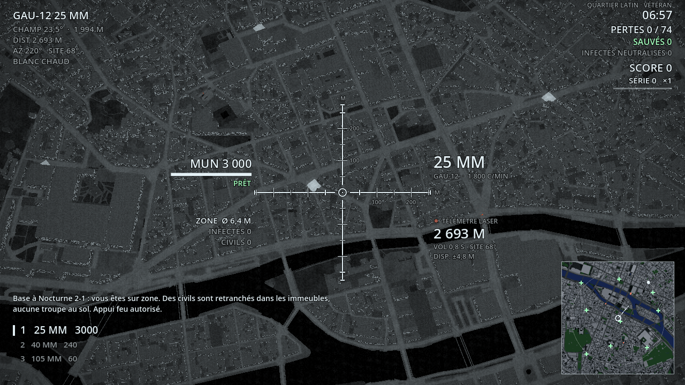

## Ce que contient (et ne contient pas) ce prototype

| | État |
|---|---|
| Boucle de jeu complète : briefing, 7 minutes de mission, victoire / défaite, rejouer | fait |
| Vue thermique (blanc chaud / noir chaud), bruit, bloom, lignes de balayage | fait |
| Orbite en virage de pylône, nacelle orientable, zoom | fait |
| 3 armes avec balistique réelle (temps de vol, dispersion, éclats, effondrement des immeubles) | fait |
| Personnages 3D articulés (13 os, environ 2 600 triangles avec les accessoires) : marche et course avec pieds posés sur le sol, torsion du bassin et du buste, boitement, siège de porte, repas, chute, relèvement | fait |
| Variété des personnages : carrure, taille, cheveux longs / queue de cheval / casquette / capuche, sac à dos, manteau, manches courtes, vêtements déchirés chez les zombies | fait |
| Civils et zombies distingués à l'écran : teinte verte / orange, silhouette droite / voûtée | fait |
| Viseur : graduation en mètres, calibre, télémètre laser, temps de vol, dispersion, recharge, personnes dans la zone, obus en vol | fait |
| Explosions : boule de feu, onde de choc, éclats qui rebondissent et refroidissent, étincelles, poussière, fumée légère, ruines qui brûlent | fait |
| Zombies sur le réseau routier, siège des portes, infiltration, fuite des civils vers des points d'évacuation | fait |
| Carte tactique, journal radio en français, marqueurs d'immeubles infestés / assiégés | fait |
| Pertes lisibles : bandeau « N civils perdus » avec la cause, la direction et la distance, compteur détaillé (immeubles, rue, tirs, rasés), conseil **RASER : OUI / NON** sous la visée et sur chaque immeuble menacé, explications à la radio, détail au bilan | fait |
| Savoir quoi faire maintenant : bandeau **URGENT** (quoi, où, avec quelle arme), immeuble à raser **rouge** dans la scène, sur le cadre et sur la minicarte, viseur attiré vers la zone urgente **en Recrue seulement**, texte de l'écran de jeu agrandi (3 tailles, touche T) | fait ; **jamais joué par un humain** (voir « Limites connues ») |
| Zone de jeu réduite de moitié (disque de 600 m de rayon) : vagues, objectifs, évacuations et bouches de métro ramenés dedans | fait ; c'est **ma lecture de « périmètre ÷ 2 »**, voir « Zone réduite… (lot 8) » |
| Carré rouge sur les infectés cachés derrière un immeuble (Recrue et Vétéran), tir guidé jusqu'à la rue | fait ; **jamais joué par un humain** |
| Rechargement propre à chaque arme : changer d'arme n'attend plus | fait |
| Groupes d'infectés qui sortent du métro et errent dans les rues (cinq secteurs), moins d'infectés qui cherchent une porte | fait |
| Civils des rues (verts) qui courent vers les évacuations et fuient les infectés | fait ; **jamais joué par un humain** |
| Son des armes : rafale de 25 mm (cadence réelle, montée en régime), 3 variantes du 40 mm, 2 du 105 mm, chargement du 105 mm, sélecteur, clic à vide, moteurs de l'avion en fond | fait |
| Radio parlée : échanges entre station directrice, avion et tireur qui annoncent les nouveaux groupes, assauts, portes forcées, pertes civiles, fin de mission (voix déformées, bruit de liaison, déclic d'émission) | fait |
| Score, séries (multiplicateur rompu par une bavure), notes S/A/B/C/D, 3 étoiles par mission, débriefing en trois pages | fait |
| Objectifs de mission annoncés par la radio (évacuer, chasser, tenir un immeuble, intercepter un groupe) et objectifs cachés, avec repères sur la vue et la carte | fait |
| Profil sauvegardé : XP, 10 grades, crédits d'appui, atelier de 26 améliorations (78 niveaux), 61 médailles, cosmétiques (13 insignes, 7 filtres thermiques, 6 réticules, 5 voix radio), page « Progression » au débriefing | fait |
| Capteurs de l'atelier : optique jusqu'à ×16, prédicteur de tir, désignateur laser | fait |
| Campagne de 5 secteurs (Quartier latin, Montmartre, Les Halles, La Défense, Stade de France) déverrouillés par les étoiles, carte de campagne, 3 difficultés (Recrue, Vétéran, Cauchemar) | fait |
| Défi du jour : un scénario par date (secteur, ville, mutateurs, vagues), identique pour tous, classement local des 10 meilleurs, série de jours | fait |
| Mode sans fin « Nuit blanche » : vagues engendrées à la volée, de plus en plus dures, records par secteur | fait |
| 6 mutateurs de règles (3 au plus à la fois) avec bonus ou malus de récompense | fait |
| Infectés spéciaux : colosse (blindé), hurleur (affole les infectés proches), alpha (mène une meute), vagues `special` dans les secteurs 2 à 5 | fait |
| Appuis ponctuels aux touches 4 à 7 : barrage d'obusiers, drone de reconnaissance, leurre sonore, largage de munitions | fait |
| Fusée éclairante parmi les appuis | **remplacée** par le largage de munitions : en imagerie thermique, un éclairage ne servirait à rien |
| Rediffusion du meilleur tir au débriefing | pas fait |
| Sons d'impact et d'effondrement | volontairement absents (trop haut pour les entendre) |
| **Carte réelle de Paris** | **fait pour cinq secteurs** (Quartier latin, Montmartre, Les Halles, La Défense, Stade de France), pas pour toute la petite couronne ; voir « Cartes réelles de Paris » |
| Son écouté et réglé à l'oreille | **pas fait** (voir « Son », limites) |
| Équilibrage affiné par de vrais joueurs | pas fait |

**Les cartes sont vraies, mais simplifiées.** Les cinq secteurs de la campagne sont découpés dans des données réelles :
bâtiments et hauteurs de la BD TOPO de l'IGN, rues, ponts, parcs et Seine d'OpenStreetMap, stations de métro. On y reconnaît le
Quartier latin (Notre-Dame, le Panthéon, le jardin du Luxembourg, l'île de la Cité), Montmartre (le Sacré-Cœur, la place du Tertre,
Pigalle), Les Halles, La Défense (la Grande Arche) et le Stade de France avec le canal Saint-Denis. Le nom du lieu survolé s'affiche
sous la visée et sur la minicarte. **Ce que la carte n'est pas** : les immeubles sont des rectangles orientés (un contour réel est
approché par plusieurs rectangles) aux toits plats, **les rues de Saint-Denis et des abords de La Défense sont déduites des vides entre
bâtiments** (l'extrait OpenStreetMap utilisé ne couvre que Paris et La Défense) et le nombre d'habitants de chaque immeuble est une
valeur de jeu, pas une donnée de population. Sources, licences (ODbL, Licence Ouverte 2.0) et limites : « Cartes réelles de Paris »
plus bas et `tools/city/README.md`. Les villes générées d'avant (« ParisLite », cinq styles) restent disponibles comme solution de repli.

## Lancer le jeu

Il faut Godot **4.4 ou plus récent** (développé et testé avec la 4.7.2, rendu « Compatibility », OpenGL 3.3).

```bash
# depuis le dossier du projet
godot --path .
```

Ou ouvrir `project.godot` dans l'éditeur Godot, puis F5.

Options (à placer après `--`) :

```bash
godot --path . -- --style=latin --seed=42   # une ville générée (styles : latin, montmartre, halles, defense, stade) au lieu de la carte réelle
godot --path . -- --size=3000          # idem, plus grande (mètres) ; --size ou --style remplacent la carte réelle du secteur
godot --path . -- --city=ma_ville.json # une ville de votre fichier (format pnc-city-1 ou pnc-city-2)
godot --path . -- --nosound            # sans aucun son (aussi : touche N en jeu)
godot --path . -- --mission=mission_03 # un secteur donné (même s'il est encore fermé) ; par défaut : le dernier joué
godot --path . -- --difficulty=nightmare   # recruit, veteran ou nightmare ; par défaut : Recrue tant qu'on n'a rien gagné, puis le dernier niveau joué
godot --path . -- --profile=essai.json # un autre fichier de profil (--noprofile : profil neuf, jamais enregistré)
godot --path . -- --daily              # le défi du jour (--daily=2026-12-25 : celui d'une autre date) ; voir « Défi du jour »
godot --path . -- --endless            # la Nuit blanche sur le secteur choisi (avec --mission=… et --difficulty=…)
godot --path . -- --mutators=fog,runners   # mutateurs de départ (brouillard, panne radio, portes fragiles, portes blindées, munitions rares, coureurs)
```

Le défi du jour et la Nuit blanche s'ouvrent normalement après une première victoire en campagne ; les options ci-dessus servent
aux essais et aux captures, et ne vérifient pas ce déblocage.

La fluidité n'a été mesurée qu'en rendu logiciel, sans carte graphique (environ 7 à 8 images par seconde
dans une machine virtuelle, avec les personnages 3D et les explosions). Sur une vraie carte graphique elle doit être
bien meilleure, mais ce n'est pas mesuré.

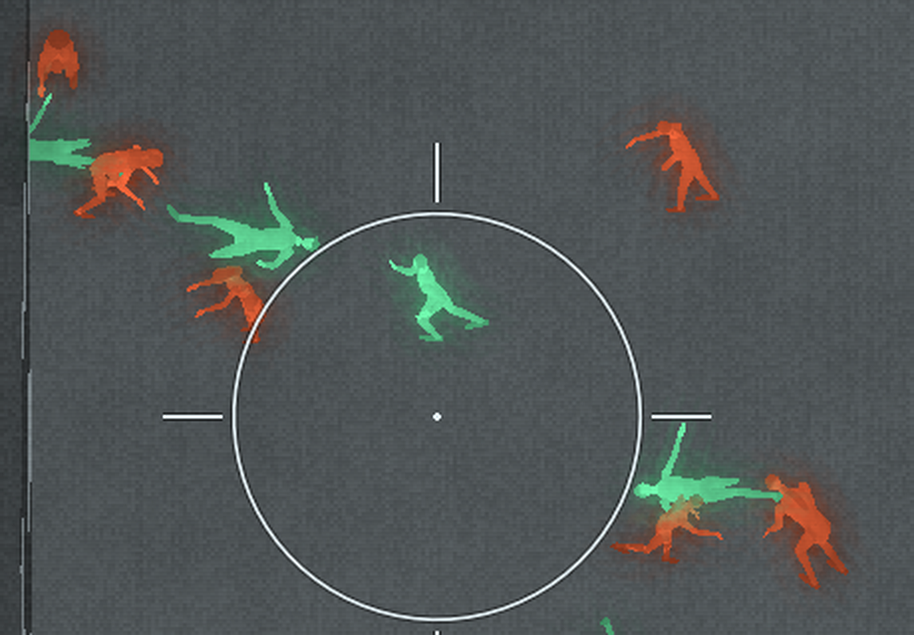

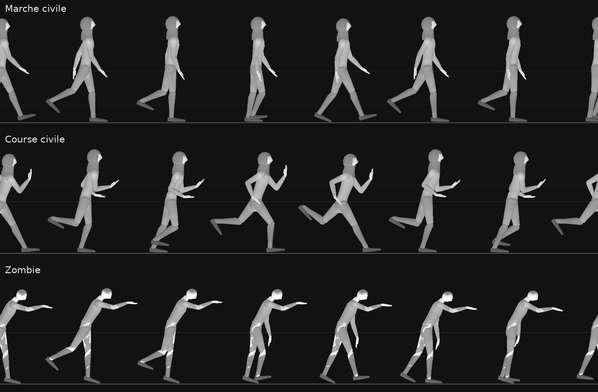

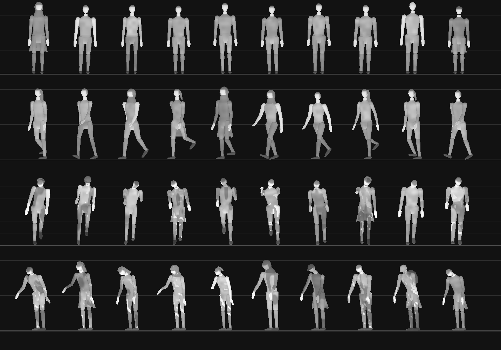

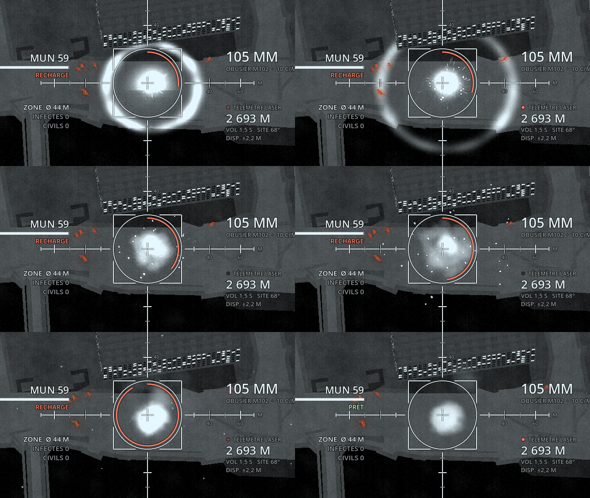

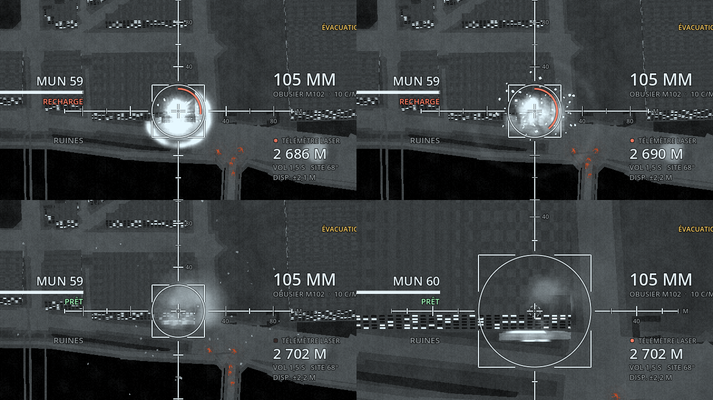

## Commandes

| Action | Touche |
|---|---|
| Orienter la nacelle | souris, ou ZQSD / WASD / flèches (Maj = ×3) |
| Tirer | clic gauche (maintenu pour le 25 mm) |
| Armes | 1, 2, 3 ou Tab |
| Appuis (au point visé) : barrage de 105 mm, drone, leurre sonore, largage de munitions | 4, 5, 6, 7 (s'ils sont achetés à l'atelier) |
| Zoom | molette (de ×0,25 à ×8, jusqu'à ×16 avec l'optique de l'atelier ; le champ descend jusqu'à 0,45°, 0,23° avec l'optique au maximum) |
| Désigner un infecté au laser (si le désignateur est acheté) | clic droit ou E ; de nouveau pour relâcher |
| Atelier (briefing et débriefing) | A |
| Carte de campagne (briefing et débriefing) | K |
| Mutateurs (briefing) | U ; 1 à 6 en active ou retire un (Échap ou Entrée pour revenir) |
| Défi du jour et Nuit blanche (briefing, carte de campagne et débriefing) | J ; puis D (défi du jour) ou N (Nuit blanche), ← → secteur, ↑ ↓ ou 1 2 3 difficulté |
| Difficulté (briefing) / sur la carte de campagne | ↑ ↓ / 1 2 3 ; ← → ou Tab pour changer de secteur |
| Nuit blanche : rendre la main à l'équipage (score conservé) | Échap pour la pause, puis Entrée |
| Blanc chaud / noir chaud | Espace |
| Teintes civils / zombies (marquage couleur) | C |
| Taille du texte de l'écran de jeu : normal, grand (par défaut), très grand | T |
| Recentrer l'orbite sur la visée | R |
| Couper / rétablir tout le son | N |
| Couper / rétablir les voix radio (garde les armes) | V |
| Carte tactique | M |
| Aide | H |
| Pause | Échap ou P |
| Commencer / rejouer | Entrée ou clic |
| Plein écran | F11 |

Les touches utilisent la position physique : sur un clavier AZERTY, ZQSD fonctionne comme WASD.

## Lire l'image

- **Civils** : teinte verte, silhouette droite. Ils marchent, ou courent quand ils fuient vers un point d'évacuation :
  buste penché, bras qui pompent, phases où les deux pieds quittent le sol. Visage et mains sont plus chauds que les
  vêtements, les chaussures sont froides.
- **Zombies** : teinte orange, silhouette voûtée, bras tendus, démarche boiteuse (certains ont un avant-bras en moins).
  Ils trottent ou courent selon leur vitesse, martèlent les portes, puis se penchent sur leurs victimes pour les dévorer.
- **Au sol** : un civil dévoré tombe (teinte verte), puis se relève en zombie (teinte orange) au bout de quelques secondes.
  Les cadavres sont froids et sans teinte.
- Les personnages sont tous différents : la graine d'apparence de chacun fixe sa carrure, sa taille, sa coiffure,
  son sac, son manteau, son style de course. Chez les zombies s'y ajoutent la posture des bras, la jambe qui traîne,
  les vêtements déchirés (peau plus chaude) et le sang séché (plus froid).
- À l'orbite par défaut, un personnage ne fait que quelques pixels de haut : le shader le grossit jusqu'à une taille
  minimale à l'écran (24 pixels, grossissement limité à ×4,2) pour qu'il reste lisible. La démarche et la course se
  voient bien à partir du zoom ×2 ou ×3.
- La touche **C** supprime les teintes si vous préférez le gris thermique pur. Elle fonctionne en blanc chaud comme en noir chaud.
- **Infectés spéciaux** : un losange avec leur nom et leur distance les désigne (le colosse y ajoute une jauge de vie) ; quand le plus
  proche est hors champ, une flèche au bord de l'écran montre la direction.
- **Immeuble rouge** : un immeuble qu'il faut raser (conseil « RASER : OUI ») est rouge dans la scène elle-même, en blanc chaud comme en noir chaud,
  avec un cadre rouge qui clignote sur son toit et un carré rouge sur la minicarte. Le rouge de la scène n'a qu'un autre emploi, de fins carrés
  (voir ci-dessous) : l'un est une surface, l'autre un contour.
- **Carré rouge sur un infecté** (Recrue et Vétéran) : un infecté **caché derrière un immeuble** est entouré d'un fin carré rouge, qui disparaît dès qu'il se
  découvre. Un tir sur ce carré est guidé jusqu'à la rue (voir « Zone réduite, rechargement par arme, infectés cachés, métro et rues »).
- **Civils des rues** : des civils verts sortent des immeubles et courent vers les points d'évacuation ; ils changent de direction devant un infecté. Ils
  comptent dans les pertes s'ils sont dévorés ou touchés par un obus, mais pas parmi les sauvés.
- **Groupes du métro** : des infectés remontent d'une bouche de métro (cercle bleu « MÉTRO ») et errent ensemble dans les rues.
- **Bandeau URGENT** (haut de l'écran, au centre) : la chose à faire maintenant, où elle est et avec quelle arme (voir « Savoir quoi faire maintenant »).
- **Appuis achetés** : une barre en bas de l'écran indique, pour chaque touche (4 à 7), PRÊT avec le nombre d'appels restants, le délai
  avant le prochain appel, EN COURS avec les secondes restantes, ou ÉPUISÉ.

## Règles

- **Défaite** : trop de civils perdus. Le seuil (`max_civilians_lost`) dépend du secteur et de la difficulté (55 au Quartier latin
  en Vétéran).
- **Victoire** : tenir jusqu'à la fin du temps (420 s au Quartier latin ; 450 s à La Défense, 480 s au Stade de France), ou
  « secteur sécurisé » quand la dernière vague est passée et qu'il ne reste plus un seul infecté.
- **Zone de jeu** : la partie se joue dans un disque de 600 m de rayon (1 200 m de diamètre) : la visée, les vagues, les évacuations et les bouches de métro n'en sortent pas.
- **Civils** : ils sont dans les immeubles (simples compteurs) ou en fuite vers un point d'évacuation. Un civil sauvé est un civil arrivé à un point d'évacuation.
  Des civils des rues courent en plus, en permanence, vers les points d'évacuation sans compter comme sauvés ; dévorés ou touchés par un obus, ils comptent comme perdus.
- **Zombies** : ils marchent sur les rues (certains courent). Environ 3 sur 10 cherchent une porte occupée et la martèlent, les autres errent et poursuivent les civils
  qu'ils croisent ; des groupes remontent du métro. Quand la porte cède, ils entrent. Dans un immeuble infesté, ils dévorent les habitants ; un civil dévoré se relève en zombie quelques secondes plus tard.
- **Détruire un immeuble** tue tout le monde à l'intérieur, zombies comme habitants. Les civils qui y restaient comptent comme perdus (`collateral_counts_as_lost`, modifiable dans `data/mission_01.json`). Quand le faire : voir « Comprendre les pertes et savoir quand raser ».
- **Armes** : le 25 mm est précis et rapide mais n'abîme presque pas les immeubles ; le 40 mm a un éclat moyen ; le 105 mm rase un immeuble ordinaire d'un coup. Les munitions se régénèrent lentement. Chaque arme a son propre rechargement : changer d'arme est immédiat.
- **Visée** : un immeuble placé devant une cible la masque, et l'obus tombe sur son toit. Il faut viser ce que l'on voit. Exception, en Recrue et en Vétéran :
  un infecté caché derrière un immeuble est entouré d'un carré rouge, et un tir sur ce carré est guidé jusqu'à lui.
- Le cercle du réticule représente le rayon d'éclat de l'arme sélectionnée (voir « Lire le viseur »).

### Comprendre les pertes et savoir quand raser

Un civil est perdu de **quatre façons**. À chaque perte, un bandeau en haut de l'écran annonce « N CIVILS PERDUS » avec la cause, la
direction et la distance du lieu, et ce qu'il faut en retenir ; le compteur PERTES en donne le détail (`IMMEUBLES 5 · RUE 2 · TIRS 1 · RASÉS 2`),
la radio l'explique et le bilan de fin de mission le répète.

| Cause | Ce qui s'est passé | Que faire |
|---|---|---|
| **Dévorés dans un immeuble** | des infectés ont forcé la porte et mangent les habitants | avant : abattre au 25 mm ceux qui martèlent la porte ; après : la règle ci-dessous |
| **Dévorés dans la rue** | un habitant qui fuyait a été rattrapé | abattre les infectés autour de l'immeuble infesté et des points d'évacuation |
| **Tués par vos tirs** | un tir a touché des civils dans la rue | lire le nombre de civils dans la zone avant de tirer (voir « Lire le viseur ») |
| **Ensevelis sous un immeuble rasé** | un obus a détruit un immeuble habité | ne raser que si l'immeuble est perdu |

**Quand raser un immeuble ? Seulement quand il est déjà perdu.** Raser tue *tous* les habitants, et les infectés qui sont avec eux : pour les
civils, ce n'est jamais une bonne affaire, c'est le moyen d'arrêter la contagion avant qu'elle ne sorte dans la rue. Le jeu fait le calcul
à votre place et l'affiche de trois façons, avec une seule règle (`BuildingSystem.advice`) : **RASER : OUI / NON** dans la colonne de droite du
viseur quand il est posé sur un immeuble, une étiquette sur chaque immeuble menacé (les plus urgents d'abord, une seule flèche de bord d'écran
vers le plus urgent des autres), et une phrase à la radio (« Immeuble perdu. Tireur, vous pouvez le raser. »).

- **OUI** : au moins 4 infectés à l'intérieur **et** au plus 14 habitants vivants. À partir de 4 infectés ils sortent en flot, un toutes les
  2,5 s : l'immeuble devient une source d'infectés qui ne tarit plus. Une fois à OUI, le conseil y reste tant qu'il y a des infectés dedans (il ne
  repasse pas à NON parce que l'un d'eux vient de sortir et que le compte retombe à 3). Deux autres cas : 2 habitants au plus avec 2 infectés
  (il n'y a presque plus rien à sauver), et l'immeuble submergé (au moins 6 infectés et au moins un tiers du nombre d'habitants, pour 60 habitants
  au plus).
- **NON, la porte tient** (étiquette « PORTE ATTAQUÉE n % ») : abattez les infectés devant la porte au 25 mm. C'est le moment où l'on sauve le plus de civils.
- **NON, tenez la rue** (« INFESTÉ ×n · NE PAS RASER » : moins de 4 infectés dedans, ou trop d'habitants à ensevelir) : les habitants fuient un à
  un ; abattez les infectés qui sortent et ceux qui rattrapent les fuyards.
- **NON, plus d'habitants** (« PLUS D'HABITANTS » sous la visée) : il n'y a plus rien à sauver, gardez vos obus.

Au score, **raser un immeuble perdu** coûte −40 points par civil, comme un civil dévoré, sans bavure ni série rompue ; **raser un immeuble qui
tenait encore** est une bavure (−150 points par civil, série rompue). Dans les deux cas les civils comptent dans le seuil de pertes, mais en
Recrue et en Vétéran ceux que vos obus ont tués n'y comptent que pour 50 ou 60 % (voir « Difficultés »).

D'où viennent les seuils (4 infectés, 14 habitants) ? Le premier est mécanique : à 4 infectés dedans, ils sortent en flot et l'immeuble ne se
vide plus. Le second a été choisi avec un robot d'essai qui applique le même conseil que le joueur ; ses résultats ne prouvent rien sur un
humain et ils sont **mitigés**. Un premier essai favorisait le rasage (sur 64 parties à Montmartre et aux Halles, en Recrue et en Vétéran :
44 victoires sans jamais raser, 55 en suivant le conseil), mais l'essai final, sur le jeu tel qu'il est livré (Vétéran, cinq secteurs, 32 parties
chacun), ne le favorise pas : 112 victoires avec le conseil, 122 sans jamais raser (Quartier latin 31 contre 29, Montmartre 23 contre 28,
Les Halles 28 contre 29, La Défense 13 contre 17, Stade de France 17 contre 19 ; l'écart est dans le bruit de la mesure). **Raser est donc un
dernier recours, pas un moyen de gagner** : le conseil sert surtout à ne pas le faire à tort (−150 points et la série rompue) et à arrêter
la contagion quand l'immeuble est déjà perdu. Le verrou (le conseil ne repasse pas à NON quand le premier infecté sort) évite que
l'étiquette ne clignote entre OUI et NON pendant que l'obus est en l'air.

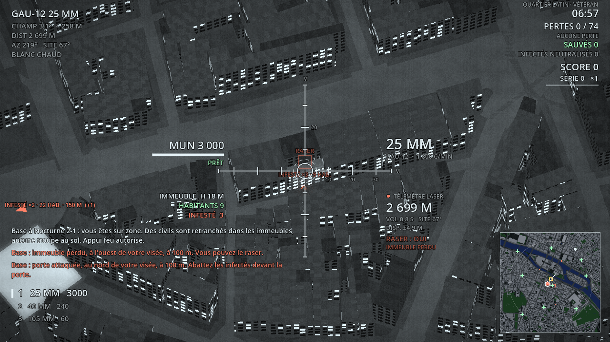

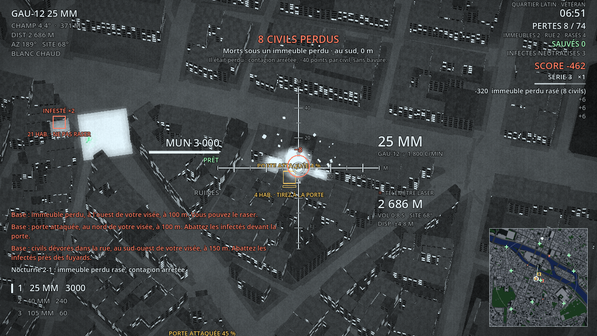

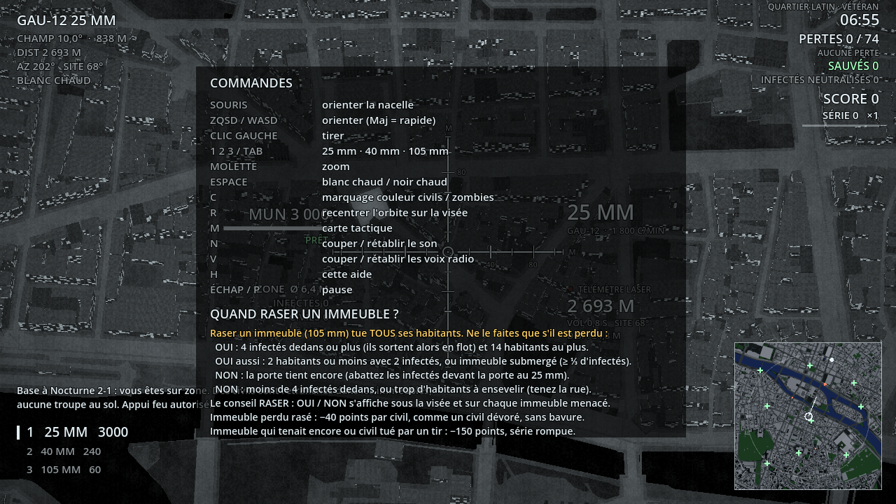

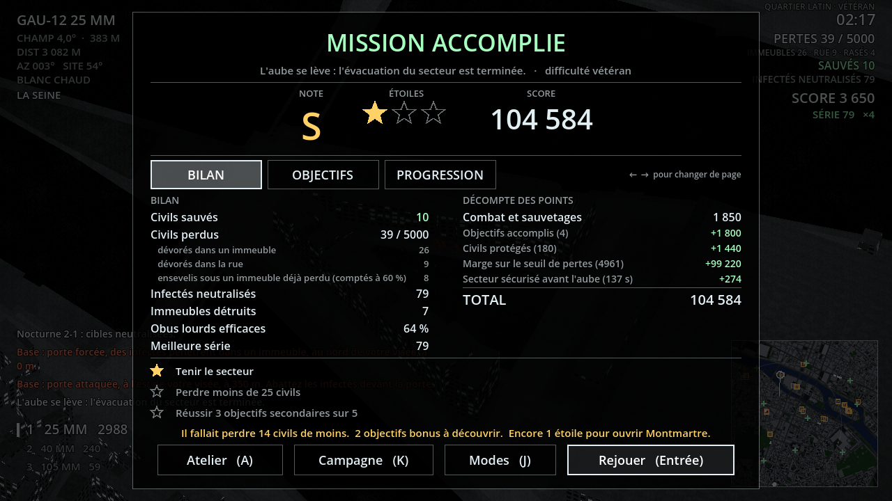

### Savoir quoi faire maintenant : bandeau URGENT, immeuble rouge, viseur assisté

Retour du 25 novembre (« c'est pas clair, on ne distingue pas ce qui est urgent, colore en rouge un bâtiment à détruire, les caractères à lire sont
trop petits ») : l'écran montrait beaucoup d'étiquettes de même poids. Le jeu calcule maintenant **une seule priorité à la fois**, la chose à faire
maintenant (`scripts/sim/priority.gd`, lue par l'affichage, par le viseur assisté et par les essais), et la montre de quatre façons.

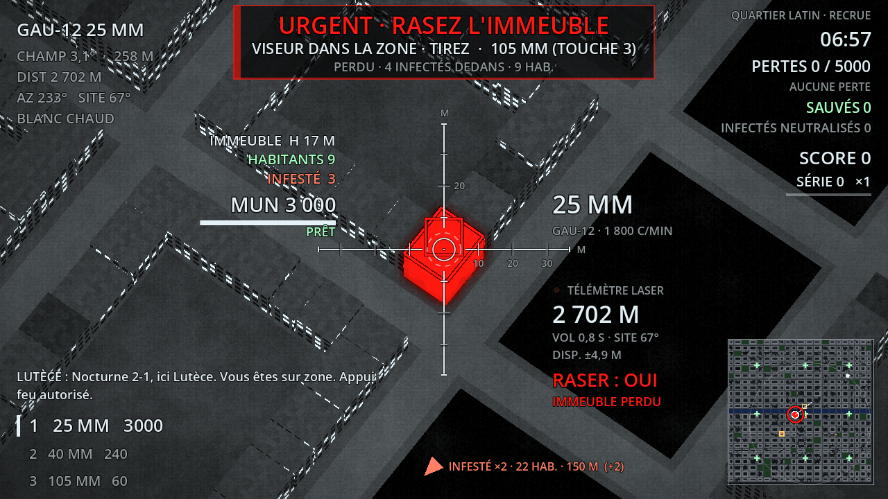

**1. Le bandeau URGENT** (haut de l'écran, au centre, pas plus large que la moitié de l'écran) tient en trois lignes : *quoi* (« URGENT · RASEZ
L'IMMEUBLE »), *où et avec quelle arme* (« AU NORD-OUEST · 770 M · 105 MM (TOUCHE 3) » : direction et distance depuis le point visé, la touche n'étant
rappelée que si l'arme conseillée n'est pas celle qu'on a en main ; ou « VISEUR DANS LA ZONE · TIREZ » quand la visée est déjà dans la zone) et *pourquoi*
(« PERDU · 4 INFECTÉS DEDANS · 9 HAB. »). Le mot de tête est URGENT (niveaux 3 à 5), PRIORITÉ (niveau 2) ou OBJECTIF (niveau 1) ; sans menace, il se réduit à
« AUCUNE URGENCE ». Les annonces de pertes viennent dessous, jamais par-dessus.

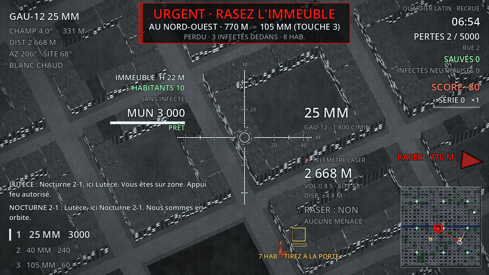

**2. Un repère sur la cible.** Dans le champ, l'immeuble visé reçoit un grand cadre et un infecté de la rue de grandes équerres ; hors champ, une grande
flèche pulsante au bord de l'écran donne la direction, avec la distance. Les autres étiquettes (immeubles menacés, infectés spéciaux, objectifs)
restent plus petites et s'écartent des textes du HUD et du bandeau au lieu de passer dessus.

**3. L'immeuble à raser est rouge.** Dès que le conseil passe à « RASER : OUI », l'immeuble devient rouge **dans la scène elle-même** (le shader
thermique le teinte : rouge vif en blanc chaud, rouge sombre en noir chaud), son toit reçoit un cadre rouge qui clignote, ses arêtes verticales sont
tracées et la minicarte montre un carré rouge cerclé d'un anneau pulsant. **Le rouge de la scène ne sert qu'à cela** : les autres alertes sont blanches, saumon ou
ambre (orange en noir chaud). Depuis le lot 8, de fins carrés rouges, et non un aplat, entourent aussi les infectés cachés derrière un immeuble en Recrue et en Vétéran
(voir « Zone réduite, rechargement par arme, infectés cachés, métro et rues »). Il s'éteint dès que l'immeuble n'est plus à raser (plus d'habitants, plus d'infectés, effondré) et se rallume si
l'immeuble redevient perdu.

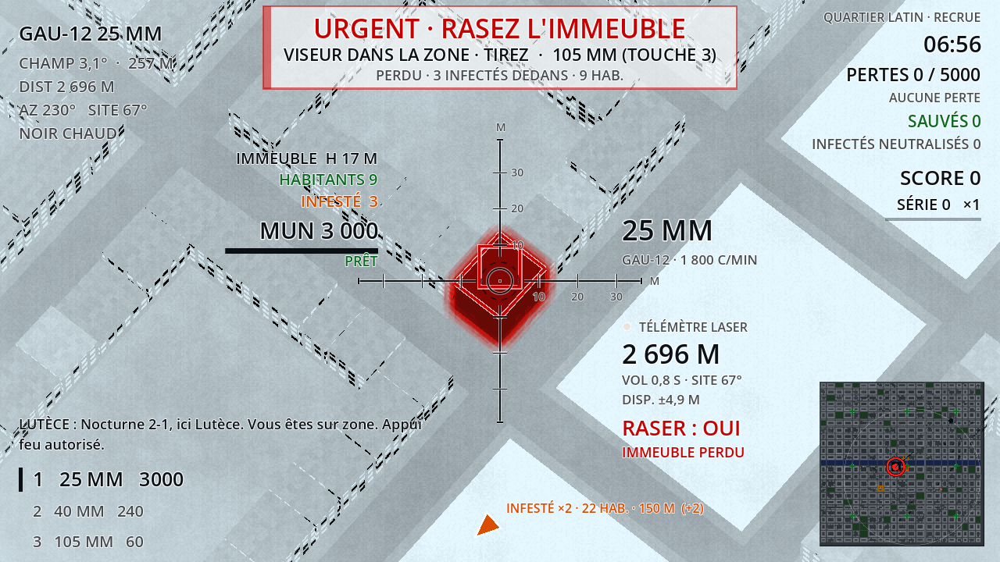

**4. Le texte est plus grand** : trois tailles (normal comme avant, **grand par défaut**, très grand), touche **T** pour passer de l'une à l'autre ;
le choix est gardé dans le profil. Voir « Taille du texte » plus bas.

#### Ce qui passe en premier

| Niveau | Situation | Bandeau | Arme conseillée | Attraction |
|---|---|---|---|---|
| 5 | immeuble perdu avec des habitants (conseil RASER : OUI) | URGENT · RASEZ L'IMMEUBLE | 105 mm | 1,0 |
| 4 | infecté à 9 m ou moins de civils en fuite | URGENT · TIREZ SUR LES INFECTÉS (« 2 CIVILS POURSUIVIS ») | 25 mm | 1,0 |
| 3 | porte attaquée à 55 % ou plus, ou déjà forcée | URGENT · DÉFENDEZ LA PORTE, ou PORTE FORCÉE | 25 mm | 1,0 |
| 3 | colosse, hurleur ou alpha en vie | URGENT · ABATTEZ LE COLOSSE, LE HURLEUR ou L'ALPHA | 105 mm, 25 mm, 40 mm | 0,8 |
| 2 | infecté entre 9 et 16 m de civils | PRIORITÉ · TIREZ SUR LES INFECTÉS | 25 mm | 0,7 |
| 2 | porte attaquée entre 12 et 55 % | PRIORITÉ · DÉFENDEZ LA PORTE | 25 mm | 1,0 |
| 2 | immeuble infesté mais pas perdu | PRIORITÉ · IMMEUBLE INFESTÉ (« NE RASEZ PAS · TENEZ LA RUE ») | 25 mm | 0,8 |
| 1 | objectif de mission en cours | OBJECTIF · DÉFENDEZ L'IMMEUBLE, COUVREZ L'ÉVACUATION (25 mm) ou INTERCEPTEZ LE GROUPE (40 mm) | selon l'objectif | 0,5 |
| 0 | rien | AUCUNE URGENCE | | |

Le niveau le plus haut gagne toujours, quelle que soit la distance ; à niveau égal, c'est la cible la plus proche de la visée. Pour que le bandeau
et le viseur ne sautent pas d'une cible à l'autre, une priorité en place est gardée au moins 3 s ; une autre de même niveau ne la remplace ensuite que
si elle est plus proche de la visée de plus de 400 m, alors qu'une priorité plus haute, ou la disparition de la cible, la remplace tout de suite.
Le calcul est refait au plus tous les 0,25 s de jeu. Les constantes sont en tête de `scripts/sim/priority.gd` (`PERIOD`, `HOLD_S`, `STICKY_M`,
`DOOR_URGENT`, `STREET_NEAR_M`, `STREET_NOW_M`). **C'est une heuristique de ce prototype** : elle range les situations dans l'ordre où les règles du jeu
les rendent coûteuses, pas dans celui qu'un joueur expert choisirait toujours.

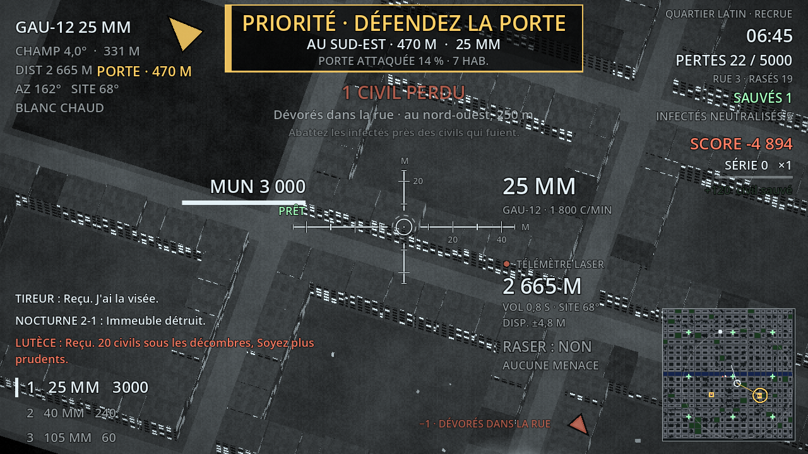

#### Le viseur assisté de la Recrue

En **Recrue seulement** (`assist` : 1,0 dans `data/difficulty.json` ; Vétéran et Cauchemar : 0, la visée n'y obéit qu'au joueur), la nacelle est attirée
doucement vers la zone de la cible urgente (`scripts/core/assist.gd`). Ce n'est qu'un **aimant** :

- il amène la visée au point du sol dont la ligne de visée passe par la cible (pour un immeuble, par son toit : vu de la canonnière, ce point est un peu
  derrière l'immeuble, et c'est bien là qu'il faut viser pour que l'obus tombe sur le toit) et **s'arrête dès que le viseur est dans la zone**
  (85 % de son rayon : 10 à 30 m pour un immeuble à raser, 20 à 26 m pour un infecté, une porte ou un immeuble à défendre, 30 m ou plus pour un objectif) ;
  il ne reprend que si la visée en sort au-delà de 125 % du rayon. Il ne place donc pas le tir à votre place : **il ne tire jamais** ;
- vitesse : au plus 180 m/s au sol, **jamais plus de 0,9 largeur d'image par seconde** (à fort zoom il va moins vite pour ne pas faire défiler l'image
  d'un coup) et jamais moins de 0,15 largeur d'image par seconde, multipliée par la colonne « Attraction » du tableau ci-dessus ; il ralentit à l'arrivée ;
- **le joueur reste maître** : tant que la souris ou le clavier déplacent la visée, l'aimant ne garde que 30 % de sa force et il retrouve toute sa force
  après 0,5 s de calme ; si le joueur s'éloigne franchement de la cible (0,35 s), l'aimant se suspend pendant 3 s ; il se tait pendant le tir et 0,7 s après,
  et quand le désignateur laser tient un infecté ;
- il ne joue que pendant la partie en cours et repart de zéro à chaque nouvelle partie.

Mesuré par les essais (`--lot7`, partie simulée, sans joueur) : de 752 m de la zone d'un immeuble à raser, la visée y entre en **5,7 s** au zoom de base
(8 m du point visé pour une zone de 10 m, puis plus aucun mouvement) et en **10,2 s** à 1° de champ (largeur d'image de 99 m au lieu de 394 m) ;
pendant que le joueur déplace la visée, l'attraction tombe à 30 % (54 m en 1 s au lieu de 180 m).

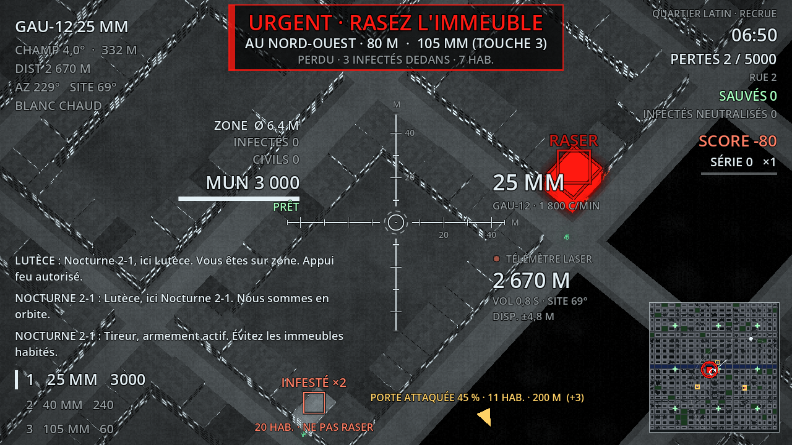

#### Taille du texte

`T` fait tourner les trois tailles du texte de l'écran de jeu (×1,0 comme avant, **×1,3 par défaut**, ×1,6) ; un message « TEXTE : GRAND » le confirme
et le choix est enregistré dans le profil (`settings.text`, de 0 à 2). Les panneaux du haut (bandeau, pertes, annonces) sont plafonnés à ×1,3 pour ne pas
manger l'écran et se placent les uns sous les autres, au-dessus des textes du viseur ; la branche haute du viseur s'arrête sous eux. **Les menus
(briefing, atelier, carte de campagne, débriefing) gardent leur taille d'avant** : seul l'écran de jeu, l'aide (H) et la pause changent.

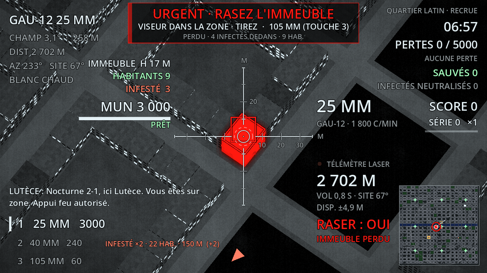

#### Ce qui est vérifié, et ce qui ne l'est pas

- **Vérifié par les essais** (`godot --headless --path . -s tests/sim_test.gd -- --lot7`, 53 vérifications, 0 échec ; suite complète : 519 vérifications,
  0 échec) : le choix de la priorité (chaque niveau, l'ordre, la tenue de 3 s, le calcul mis en cache), le rouge transmis au rendu et éteint quand
  il faut, l'arrivée de la visée dans la zone sans la dépasser ni trembler, le plafond de vitesse à fort zoom, la reprise de main du joueur, le silence
  pendant le tir, l'absence totale d'aide en Vétéran et en Cauchemar, l'enregistrement et les bornes du réglage de texte, et l'ordre d'appel dans `main.gd`.
- **La simulation n'a pas changé** : quatre parties du robot d'essai en Recrue à Montmartre (graines 1914, 1945, 1976 et 2007) donnent exactement les
  mêmes résultats avec la version précédente et avec celle-ci. Le robot ne passe pas par l'aimant (il commande lui-même la visée) : cette comparaison
  prouve que les règles n'ont pas bougé, pas que l'aimant aide.
- **Textes qui se recouvrent** : le HUD note le rectangle de chaque texte (`debug_rects`, `report_overlaps()`). Les neuf vues témoins du scénario
  `urgent` ne montrent aucun chevauchement aux trois tailles. Un contrôle image par image, dans une scène volontairement chargée (trois pertes qui
  s'empilent, flèches de bord d'écran, immeubles menacés sur le trajet de la visée, 259 images), relève des images isolées où deux textes se touchent :
  **de 2 à 4 images sur 259 au texte normal, 2 au texte par défaut, 9 ou 10 au texte très grand** (deux passages par taille, qui diffèrent de quelques images ;
  elles surviennent au moment où un panneau apparaît, où une étiquette bouge ou où le conseil « RASER » s'affiche : la mise en page se règle d'après l'image précédente). Ce n'est pas zéro, et au texte très grand, sur une fenêtre de
  720 lignes, l'écran est plus chargé et ces cas sont plus fréquents : c'est le texte « grand » qui a été réglé avec le plus de soin.
- **Non vérifié** : l'effet de l'aimant **sur un joueur** (confort, sensation de « glissement », réglage des 180 m/s, de 0,9 largeur d'image par seconde
  et du 30 %) ; il n'a été essayé qu'en simulation. La pertinence de l'ordre des priorités pour un humain. L'aspect du rouge sur autre chose que les
  captures du secteur du Quartier latin (les autres secteurs et les autres difficultés n'ont pas été regardés un par un). Les scènes très chargées au-delà
  du scénario d'essai.

### Zone réduite, rechargement par arme, infectés cachés, métro et rues (lot 8)

Retour du 26 novembre (« c'est mieux mais pas suffisant ») : six demandes, traitées ensemble. Le tableau dit ce qui a été fait et où le régler ;
chaque point est détaillé ensuite, avec ce qui a été mesuré et ce qui ne l'a pas été.

| Demande | Ce qui a été fait | Où le régler |
|---|---|---|
| 1. Restreindre le périmètre par 2 | la partie se joue dans un disque de **600 m de rayon** (1 200 m de diamètre au lieu de 2 400 m de côté) ; vagues, objectifs, évacuations et bouches de métro y sont ramenés | clé `zone` des missions, `tools/city/rezone.py` |
| 2. Carré rouge sur les zombies « lockés », seulement derrière un immeuble | un fin carré rouge entoure chaque infecté **caché par un immeuble** (Recrue et Vétéran) ; un tir sur ce carré est guidé jusqu'à la rue | clé `lock` de `data/difficulty.json`, `scripts/core/lock.gd` |
| 3. Changer d'arme sans attendre le rechargement de la précédente | chaque arme a son propre rechargement, qui continue en arrière-plan | `scripts/core/arms.gd` |
| 4. Groupes de zombies qui errent dans les rues en sortant du métro | des vagues `metro` dans les cinq secteurs : un groupe remonte d'une bouche de la zone et erre ensemble | `waves` (type `metro`) des missions |
| 5. Moins de zombies qui essaient d'entrer dans les immeubles | 3 infectés sur 10 seulement cherchent une porte ; les autres errent dans les rues | `rules.seek_ratio` |
| 6. Plus de civils (verts) qui courent dans les rues et ont peur des zombies | de 30 à 45 civils des rues en permanence : ils sortent des immeubles, courent vers un point d'évacuation et fuient les infectés proches | `rules.amb_*` |

#### 1. La zone de jeu : un disque de 600 m de rayon

Avant, les 2 400 m × 2 400 m de la carte étaient jouables. Désormais la clé `zone` de chaque mission (`cx`, `cz`, `radius_m`) borne la partie à un
**disque de 600 m de rayon** autour du centre du secteur (au Stade de France, décalé de 300 m vers le nord : le stade est entouré d'un grand vide).
Ce qui en dépend :

- **la visée** reste dans le disque (elle est retenue au bord) ; le décor autour est toujours dessiné, mais vide ;
- **les vagues et les objectifs** n'apparaissent que dedans, avec des rayons divisés par deux (`r_min`, `r_max`, `radius`, `max_evac`) ;
- **les 9 points d'évacuation** (une grille 3 × 3 resserrée autour du centre) et **8 bouches de métro** sont dans le disque : `tools/city/rezone.py` les
  replace (voir « Cartes réelles de Paris ») ;
- **la minicarte** ne montre que le disque, avec 40 m de marge ;
- **l'orbite ne change pas** (rayon de 800 à 1 200 m, altitude, vitesse) : la canonnière tourne à 200 m au moins du bord du disque et l'image garde
  la géométrie d'avant ;
- une mission sans clé `zone` se joue sur toute la carte, comme avant (missions de travail, anciens fichiers).

**Comment « restreindre le périmètre par 2 » a été compris.** J'ai divisé par deux la **dimension** de la zone (diamètre de 1 200 m au lieu de
2 400 m), ce qui divise sa **surface** par plus de cinq (1,13 km² au lieu de 5,76 km²). Si l'idée était de diviser la surface ou le périmètre par
deux, le disque devrait être plus large (rayon d'environ 960 m pour la surface, 760 m pour le périmètre de l'ancien carré) : il faut alors changer
`radius_m` dans les cinq missions **et** `ZONE_R` dans `tools/city/rezone.py`, relancer ce script et adapter la vérification de `_lot8_data` dans
`tests/sim_test.gd`, qui attend 600 m.

#### 2. Le rechargement est propre à chaque arme

Avant, la cadence était celle de l'arme en main : on quittait l'obusier qui venait de tirer et la nouvelle arme attendait ses 6 s. Maintenant chaque
arme a **sa propre minuterie** (`Arms.cooldowns`) : changer d'arme (1, 2, 3 ou Tab) ne crée aucun délai et ne touche à aucune minuterie. Une arme que l'on
vient de quitter **finit de se recharger en arrière-plan** : après un coup de 105 mm, passer au 25 mm ou au 40 mm est immédiat, et le 105 mm est prêt 6 s
après son coup, qu'on le tienne ou non. Revenir au 105 mm avant la fin de ses 6 s ne le rend pas prêt plus tôt : c'est le même obusier. Dans la liste
des armes (en bas à gauche), une barre sous chaque arme qui se recharge (40 mm et 105 mm) se remplit jusqu'à PRÊT, même pour celles qu'on ne tient pas ;
l'arc rouge autour du réticule suit toujours l'arme en main.

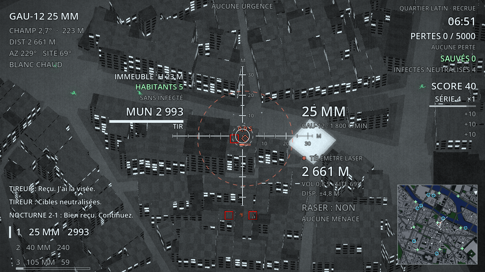

#### 3. Les carrés rouges : les infectés cachés derrière un immeuble

Vu de la canonnière, un immeuble masque la rue derrière lui : on voit des infectés disparaître, et un obus tiré à cet endroit tombe sur le toit.
Le jeu garde donc les yeux sur eux (`scripts/core/lock.gd`) :

- **un fin carré rouge** entoure chaque infecté vivant dont la ligne de vue est coupée par un immeuble (même test que pour la visée :
  `BuildingSystem.blocked`). **Un infecté en vue n'a pas de carré**, et le carré disparaît dès qu'il se découvre. Un cadavre n'en a pas. La mesure est lissée
  (2 mesures sur 3) pour que le carré ne clignote pas. Le côté est de 3,2 m au sol, borné entre 16 et 52 px au texte normal ; 90 carrés au plus, les plus
  proches de la visée d'abord ; un carré qui tomberait sur un texte du HUD ou sur un autre carré est sauté ;
- **un tir sur le carré est guidé** : si le rayon de visée touche un immeuble mais passe, au sol, à moins du rayon d'éclat de l'arme (3,2 m au 25 mm,
  8 m au 40 mm, 22 m au 105 mm) d'un infecté verrouillé, l'obus n'éclate pas sur le toit : il tombe dans la rue à cet endroit, comme s'il avait été tiré
  sur un infecté à découvert. C'est une **abstraction de jeu**, pas de la balistique : c'est elle qui donne son sens au mot « locké » (viser le carré suffit) ;
- **l'immeuble à raser garde ses obus** : le rouge « RASER : OUI » (aplat teinté dans la scène, cadre qui clignote, carré sur la minicarte) reste le
  signe d'un immeuble perdu, et un tir sur cet immeuble n'est jamais dévié. Les deux rouges ne se confondent pas : l'un est une surface, l'autre de fins
  carrés autour de silhouettes ;
- **par difficulté** (`lock` dans `data/difficulty.json`) : 1 en Recrue et en Vétéran, 0 en Cauchemar (ni carré ni obus guidé) ;
- **coût** : le calcul est étalé (16 infectés évalués par image au plus, une passe toutes les 0,15 s, 120 infectés au plus, les plus proches de la
  visée). Mesuré dans les essais, sans affichage : 0,9 ms par image en moyenne et 2,8 ms au pire avec 120 candidats.

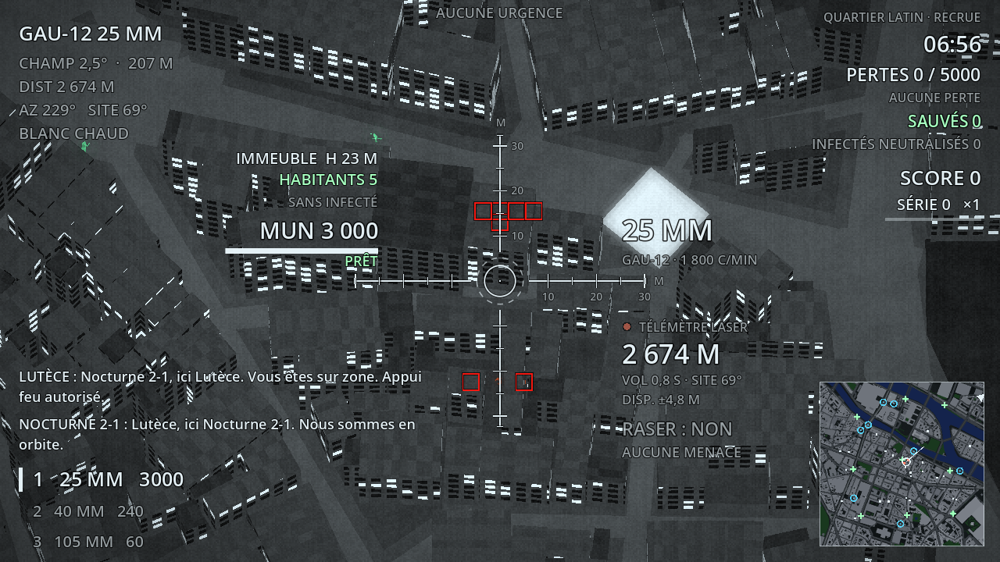

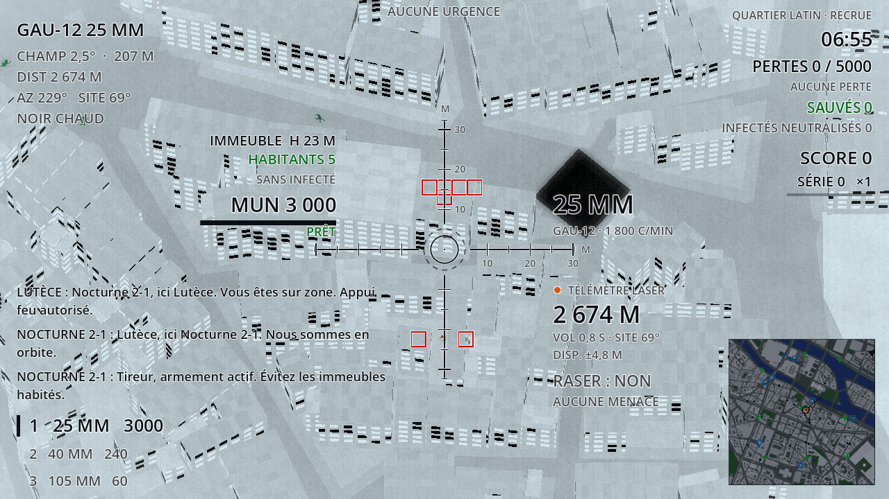

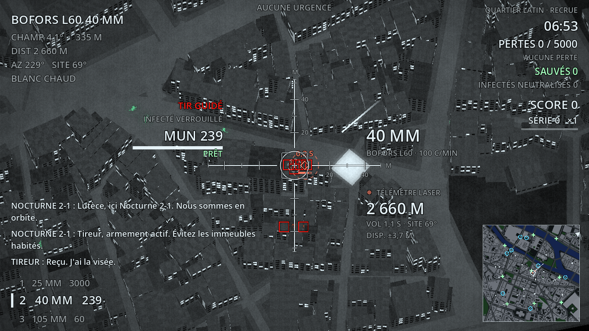

#### 4. Les groupes qui sortent du métro

Chaque secteur a maintenant des vagues `metro` (de 3 à 8 par secteur, selon sa durée) : un groupe de 3 à 9 infectés (avant l'effet de la difficulté) remonte
d'une des 8 bouches de métro de la zone, choisie entre `r_min` et `r_max` du centre d'orbite et à plus de 80 m de la visée. La radio l'annonce
(« un groupe d'infectés remonte du métro »), une fumée marque la bouche, et la bouche est repérée par un cercle bleu « MÉTRO » sur la vue et sur la carte
tactique. Le groupe **erre ensemble** : tous ses membres partagent le même but pendant 40 s, puis un autre ; ils **n'attaquent pas les portes** mais
poursuivent les civils qu'ils croisent (voir 6). Quels sont les bouches ? Aux Halles, les 8 sont de vraies stations (Sentier, Réaumur-Sébastopol, Étienne
Marcel, Bourse, Les Halles) ; au Quartier latin et à Montmartre, 4 sur 8 (Saint-Michel et Cité ; Anvers et Pigalle) ; à La Défense, 2 sur 8 (la Grande Arche) ;
au Stade de France aucune (la station est sur le RER B, que les données utilisées ne couvrent pas). Les autres sont de simples carrefours, que le jeu traite
de la même façon : **ce sont des repères de jeu, pas un plan du métro**.

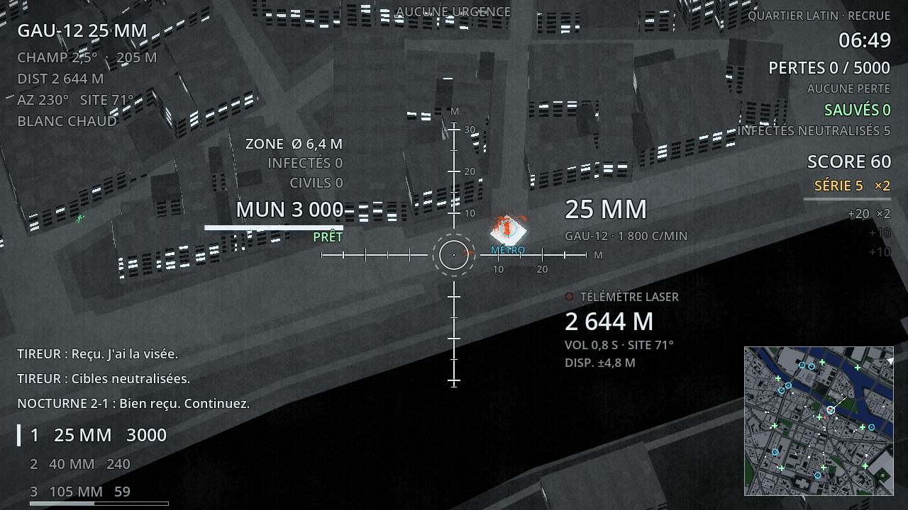

#### 5. Moins d'infectés à l'assaut des immeubles

Avant, tout infecté de la rue cherchait une porte occupée. Maintenant **3 sur 10 seulement** le font (`rules.seek_ratio` = 0,3 ; sans cette règle, 1,0 comme
avant) : les autres **errent** dans les rues et ne s'en prennent qu'aux civils qui passent à portée. Les assauts, les brèches et les groupes marqués d'un
objectif « intercepter » visent toujours une porte (c'est leur raison d'être). Mesuré dans une partie simulée : 32 % des infectés des rues cherchent une porte.
Les civils relevés après avoir été dévorés tirent eux aussi leur rôle au sort.

#### 6. Des civils dans les rues

En plus des habitants qui fuient un immeuble envahi, **de 30 à 45 civils des rues** (`rules.amb_target`, selon le secteur) sont présents en permanence.
Un civil sort de la porte d'un immeuble habité de la zone (intact, à plus de 60 m d'un infecté) toutes les 1,6 s tant que le nombre voulu n'est pas atteint
(`amb_spawn_s`), **court** vers un point d'évacuation et disparaît en y arrivant. S'il voit un infecté à moins de 45 m (`amb_fear_m`), il **change de cap**
et file vers la sortie qui l'éloigne le plus de lui ; s'il est acculé, il fuit à l'opposé puis se terre. Un infecté errant qui passe à moins de 28 m
(`amb_chase_m`) le poursuit. Ce que cela change pour vous :

- **ils comptent** : un civil de la rue dévoré est une perte « dévorés dans la rue » (seuil de défaite, bandeau, bilan) ; un civil tué par un obus est une
  perte « tués par vos tirs », avec le poids de la difficulté (50 % en Recrue, 60 % en Vétéran) ; la règle « infecté à 9 m ou moins de civils » du bandeau
  URGENT et le compteur de civils de la zone du viseur les prennent en compte ;
- **ils ne rapportent rien** : arriver à un point d'évacuation ne les ajoute ni aux sauvés, ni au score, ni aux objectifs d'évacuation (ils quittent la zone
  sans bruit) ; sinon, laisser le jeu en fabriquer suffirait pour gagner des étoiles. Ils servent de **raison de tirer juste** et d'appât pour les infectés.

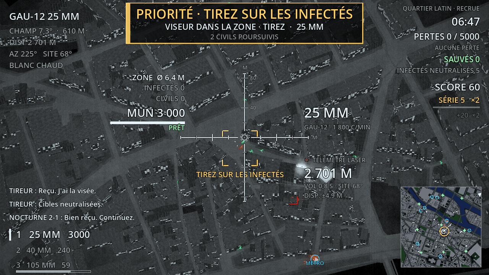

#### Ce qui est vérifié, et ce qui ne l'est pas (lot 8)

- **Vérifié par les essais** (`godot --headless --path . -s tests/sim_test.gd -- --lot8`, 61 vérifications, 0 échec ; suite complète : 581
  vérifications, 0 échec) : les données des cinq missions (zone, orbite hors du disque, vagues et objectifs dans la zone, groupes du métro, règles de la foule) ;
  le rechargement par arme (aucun délai au changement, rechargement en arrière-plan, l'obusier pas prêt plus tôt) ; la zone (visée retenue, apparitions,
  évacuations et métro dans le disque) ; la part de chercheurs de porte ; les groupes du métro (ils marchent ensemble, plus serrés que des errants isolés, sans
  attaquer de porte) ; les civils des rues (apparition, course, fuite, sortie sans être comptés comme sauvés, perte « rue » quand ils sont dévorés, victimes
  collatérales) ; les carrés rouges (caché ou non, cadavre, immeuble à raser, Cauchemar) et le guidage (un obus de 40 mm tiré sur un infecté caché tombe
  dans la rue et le tue).
- **Mesuré** : un joueur qui ne fait rien perd un secteur plus tard qu'avant, et le robot d'essai gagne beaucoup plus souvent (voir « Équilibrage ») ; à
  chaque bouche, un groupe du métro s'éloigne de 41 à 44 m en 30 s (moyenne sur les 8 bouches) et reste plus groupé que des errants isolés partis du même
  point (écart maximal au centre du groupe : 25 m contre 52 m au Quartier latin, 36 m contre 47 m à La Défense) ; en 120 s, 47 civils des rues atteignent une
  sortie sans qu'aucun ne soit compté comme sauvé ni perdu ; sur quatre captures, dans quatre secteurs, un obus de 40 mm tiré sur 5 infectés cachés en laisse
  debout 0, 0, 1 et 2.
- **Contrôle du texte du HUD** : les neuf vues témoins du scénario `lot8` ne montrent aucun texte qui en recouvre un autre, aux trois tailles de texte
  (0, 1 et 2). Mais sur 259 images d'une scène chargée (Quartier latin, Recrue), le contrôle image par image relève **13 images où deux textes se touchent
  au texte normal, 1 au texte par défaut et 12 au texte très grand** (une passe sur le code livré ; d'autres passes, sur d'autres secteurs ou avant les
  dernières retouches, ont donné 8 au texte normal, de 1 à 5 au texte par défaut et 16 au texte très grand). Ce n'est pas zéro : ce sont surtout le texte du réticule qui passe sur le panneau d'objectif (texte normal), des flèches « RASER » de bord d'écran
  qui se touchent et le bandeau des pertes qui touche « AUCUNE MENACE » (texte très grand), sur quelques images isolées.
- **Non vérifié** : tout ce qui dépend d'un joueur humain. Le confort de la visée sur un carré rouge, l'impression de « verrouillage », la lisibilité des
  carrés quand il y en a 30 ou 40, le nombre de civils des rues (30 à 45 : est-ce assez pour que les rues paraissent vivantes ?), le comportement des
  groupes du métro, la part de 30 % de chercheurs de porte. L'aspect sur d'autres secteurs et difficultés que ceux des captures. Le robot d'essai ne se sert
  ni des carrés ni des obus guidés (il vise lui-même ce qu'il voit) : les chiffres d'équilibrage mesurent l'effet de l'ensemble « zone, chercheurs de porte,
  métro, civils des rues », sans séparer la part de chacun, et **pas l'aide du carré rouge**.

## Score, séries, étoiles et notes

La mission se termine par un **débriefing** : note (S, A, B, C ou D), étoiles (trois par mission), score, décompte détaillé
des bonus et, pour la note ou l'étoile suivante, ce qu'il vous manquait (« il vous manquait 412 points pour passer en A »).

- **Éliminations** : 10 points par infecté (14 pour un coureur, 6 pour un infecté abattu dans un immeuble), multipliés
  par la **série** en cours : ×2 à partir de 5 éliminations d'affilée, ×3 à partir de 15, ×4 à partir de 30.
- **Une bavure rompt la série** : un civil tué par vos tirs ou enseveli sous un immeuble qui tenait encore (−150 points chacun) remet la
  série et le multiplicateur à zéro. Un civil dévoré coûte −40 points, tout comme un civil enseveli sous un immeuble déjà perdu (conseil
  RASER : OUI) ; un civil sauvé rapporte +120 points (jamais multiplié).
- **Bonus de fin** (en cas de victoire seulement) : 8 points par civil protégé et vivant, 20 points par civil de marge
  avant la limite de pertes, 2 points par seconde restante.
- **Obus lourds efficaces** : part des obus de 40 mm et de 105 mm qui ont touché au moins un infecté. Le 25 mm, qui tire
  30 coups par seconde, n'est pas compté.
- **Note** : seuils `score_targets` de la mission, dans l'ordre C, B, A, S (Quartier latin : 3 000, 5 500, 8 500, 12 000 ;
  Stade de France : 5 000, 9 000, 14 000, 20 000). En dessous du premier seuil, la note est D.
- **Étoiles** : une liste de conditions par mission (`stars`). Types disponibles : `win`, `lost_max`, `collateral_max`,
  `destroyed_max`, `kills_min`, `saved_min`, `score_min`, `rating_min`, `objective`, `objectives_min`.
  Quartier latin : tenir le secteur, perdre moins de 25 civils, réussir 3 objectifs secondaires sur 5. Les étoiles et les notes
  ne changent pas avec la difficulté.
- Le total affiché ne descend jamais sous zéro ; le sous-total, lui, peut être négatif (il s'affiche alors en rouge).
- Tout le barème est dans `data/scoring.json` (`points`, `chain_tiers`, `feed_s` = durée d'affichage du fil de points).

Le débriefing a trois pages, **BILAN**, **OBJECTIFS** et **PROGRESSION** (flèches ← →, ou Tab). La page des objectifs montre ceux que la
radio a annoncés (réussis ou perdus, avec la raison) et, pour les objectifs cachés, ceux qui ont été trouvés ; les autres
restent masqués (« ? ? ? »).

## Objectifs de mission

Pendant la mission, la radio confie des **objectifs secondaires** : au plus deux à la fois (`max_active_objectives`), chacun
avec un délai, une récompense en points, un repère sur la vue (losange, ou flèche en bord d'écran quand il est hors champ,
avec la distance), un repère sur la carte et une ligne dans le panneau à droite de l'écran (titre, chrono, avancement).
Les **objectifs cachés** ne sont jamais annoncés : une bannière s'affiche quand on en accomplit un.

| Type | Principe |
|---|---|
| `evac` | un immeuble habité vient d'être infiltré ; sauver `count` civils (arrivés à un point d'évacuation) avant la fin du délai. L'immeuble est choisi à moins de `max_evac` m (300 par défaut) d'un point d'évacuation. |
| `hunt` | neutraliser `count` infectés avant la fin du délai |
| `hold` | des infectés (`zombies`, plus des renforts datés dans `reinforce`) assiègent un immeuble : aucun ne doit y entrer avant la fin du délai ; l'objectif est perdu si l'immeuble est détruit |
| `intercept` | un groupe marqué de `count` infectés apparaît dans les rues : l'anéantir avant qu'il ne gagne les immeubles (`allow` entrées tolérées) |
| `shell_kills` (caché) | `value` infectés neutralisés par un seul obus |
| `long_shot` (caché) | une élimination à plus de `value` mètres |
| `chain` (caché) | `value` éliminations d'affilée sans bavure |
| `clean_run` (caché) | `value` secondes sans victime collatérale |
| `sharp` (caché) | `value` obus lourds de suite qui touchent au moins un infecté |

Les objectifs sont décrits dans `data/mission_01.json` (clé `objectives` : `id`, `kind`, `type`, `t` = date d'apparition en
secondes, `duration`, `title`, `text`, `reward.points`, plus les paramètres du type). Un objectif échoue si son délai
s'écoule, si l'immeuble visé est détruit ou si l'objectif devient impossible ; il est abandonné à la fin de la mission.

**La radio dit exactement ce que le jeu demande.** Les durées, nombres de civils, nombres d'infectés et tailles de groupe
sont prononcés à partir de phrases préenregistrées : les valeurs d'un objectif doivent donc tomber sur les valeurs prévues
dans `data/radio_script.json` (durées de 30 à 180 s par pas de 10, civils de 2 à 12, infectés à neutraliser de 10 à 40 par
pas de 5, groupes de 8 à 30 par pas de 2). Le test `_test_objectives` le vérifie et contrôle aussi que la banque de voix
contient toutes les phrases nécessaires.

## Progression, atelier et médailles

Chaque mission rapporte de l'**expérience (XP)** et des **crédits d'appui (CA)**. L'XP cumulée fixe le **grade** ; les crédits
s'échangent contre des améliorations à l'**atelier** (touche A au briefing et au débriefing). Tout est conservé dans un profil.

**Profil.** Fichier `profile.json` dans le dossier de données du jeu (sous Linux :
`~/.local/share/godot/app_userdata/Paris Night Gunship/` : le dossier a gardé le nom du titre de travail, réglé par `custom_user_dir_name` dans
`project.godot`, pour que les profils déjà enregistrés restent lisibles). L'écriture est atomique (fichier temporaire puis renommage). Un fichier
illisible est copié en `profile.json.bad` et le profil repart de zéro, sans bloquer le jeu ; les identifiants inconnus sont écartés
et les niveaux ramenés dans leurs bornes. `--profile=chemin.json` utilise un autre fichier, `--noprofile` un profil neuf qui n'est
jamais enregistré. Les essais automatiques (`--autopilot`) n'écrivent jamais dans le vrai profil.

**XP et crédits** (`data/progression.json`, clés `xp` et `credits`) :

| | par point de score | victoire | par étoile | par objectif | par objectif caché | nouvelle étoile | meilleure note | défaite |
|---|---|---|---|---|---|---|---|---|
| XP | 0,1 | +150 | +100 | +40 | +60 | +80 | +60 | 40 % conservés |
| Crédits | 0,01 | +50 | +40 | +15 | +20 | +60 | +40 | 50 % conservés |

Les bonus « nouvelle étoile » et « meilleure note » ne se paient qu'une fois par condition. Les médailles et les primes de
promotion s'y ajoutent. Les perks de l'équipage « Mentor » et « Intendant » majorent l'XP et les crédits de 5 à 15 %.

| Grade | XP requise | Prime de promotion |
|---|---|---|
| Sergent | 0 | — |
| Sergent-chef | 1 000 | 100 CA |
| Adjudant | 2 600 | 150 CA |
| Adjudant-chef | 4 800 | 200 CA |
| Major | 7 600 | 250 CA |
| Lieutenant | 11 000 | 300 CA |
| Capitaine | 15 500 | 400 CA |
| Commandant | 21 000 | 500 CA |
| Lieutenant-colonel | 28 000 | 650 CA |
| Colonel | 37 000 | 800 CA |

Ordre de grandeur (estimation d'après le test du profil, pas mesuré avec des joueurs) : une victoire notée B rapporte environ
1 200 XP et 300 CA ; l'atelier complet coûte 29 300 CA.

**Atelier** (`data/upgrades.json`) : 26 améliorations de 3 niveaux, soit 78 niveaux. Chaque niveau a un coût en crédits et un
grade minimum ; les niveaux s'achètent dans l'ordre.

| Rubrique | Améliorations |
|---|---|
| 25 mm, 40 mm, 105 mm (une série par arme) | munitions et régénération (caissons, chargeurs, soute à obus), précision (dispersion −10 / −20 / −30 %), dégâts et rayon d'éclat, cadence |
| Capteurs | optique à fort grossissement, prédicteur de tir, désignateur laser (voir plus bas) |
| Appuis | barrage d'obusiers, drone de reconnaissance, leurre sonore, largage de munitions (voir « Appuis ponctuels ») |
| Équipage | portes renforcées (+10 à +30 %), guide d'évacuation (civils +8 à +24 % de vitesse), officier de renseignement (+10 à +30 s par objectif), instructeur de tir (une bavure ne remet à zéro que 75, 50 ou 25 % de la série), soutier (régénération des munitions), mentor (+XP), intendant (+crédits) |

Les effets d'une amélioration s'appliquent au lancement de la mission : en quittant l'atelier après un achat, le jeu
reconstruit le monde avec les nouvelles armes. Chaque niveau indique l'effet **total** (pas l'incrément), dans `effects` :

- `w0.<stat>`, `w1.<stat>`, `w2.<stat>` (ou `w*.<stat>` pour toutes les armes) : variation **relative** d'une caractéristique de
  `data/weapons.json` (`ammo`, `rpm`, `dispersion_mrad`, `damage_person`, `damage_building`, `splash_radius_m`, `flash_radius_m`,
  `regen_per_s`). 0,2 vaut +20 % ; les pourcentages de plusieurs sources s'additionnent ; munitions et cadence sont arrondies et
  les valeurs ne descendent pas sous un plancher (`MIN_STAT` dans `scripts/meta/upgrades.gd`).
- `mod.<clé>` : réglage **absolu** lu par le jeu avec `ctx.mod(clé)`. `predict`, `zoom_max` et `laser` prennent le maximum ;
  `door_hp`, `civ_speed`, `obj_time_s`, `chain_keep`, `xp_bonus` et `credit_bonus` s'additionnent ; `sup_barrage`, `sup_drone`,
  `sup_decoy` et `sup_drop` donnent le niveau de chaque appui (0 : non acheté). Les délais d'objectifs
  ajoutés (`obj_time_s`) doivent rester des multiples de 10 et ne pas dépasser 180 s au total : la radio ne sait prononcer
  que ces durées (le test le vérifie).

**Capteurs.**

- *Optique à fort grossissement* : zoom maximal ×10, ×12, ×16 ; le champ minimal passe de 0,45° à 0,36°, 0,30°, 0,23°.
- *Prédicteur de tir* : un obus met 0,8 à 1,5 s à tomber, et les infectés avancent pendant ce temps. Toutes les 0,25 s le
  jeu mesure le déplacement des personnes proches du réticule. **Niveau 1** : marqueur d'anticipation (cercle pointillé de la
  taille de l'éclat, croix) à l'endroit où sera la grappe d'infectés la plus proche du réticule quand l'obus arrivera, avec un trait
  depuis sa position actuelle (jaune ; vert quand le réticule est déjà dans le cercle) ; hors du champ, une flèche en bordure
  d'écran. **Niveau 2** : estimation des infectés que le tir en cours toucherait à l'arrivée (« À L'IMPACT ~N INFECTÉS »,
  sous le télémètre). **Niveau 3** : même estimation pour les civils (« ~N CIVILS EXPOSÉS », qui clignote) pour éviter la bavure.
  Une mesure aberrante (personnage réutilisé, déplacement supérieur à 6 m/s) est ignorée. Ce sont des estimations : elles ne
  tiennent pas compte de la dispersion des tirs ni des changements de direction.
- *Désignateur laser* : clic droit (ou E) désigne l'infecté le plus proche du réticule, dans un rayon de 30 m (**niveau 1**),
  60 m (**niveau 2**) ou 100 m (**niveau 3**) ; la nacelle le suit (quatre équerres vertes et la mention « VERROU LASER »). Le
  verrou saute si vous détournez nettement la nacelle (plus de 2,5 fois le rayon, au moins 70 m), si la cible disparaît (niveau 1)
  ou s'il n'y a plus d'infecté à portée. **Niveau 2** : un nouvel infecté proche de la cible tombée est désigné automatiquement, et
  la visée est avancée du chemin que la cible parcourra pendant le vol de l'obus. **Niveau 3** : tant que le verrou tient, la
  dispersion du 40 mm et du 105 mm est divisée par deux (mesuré : 7,8 m -> 3,9 m pour le 40 mm).

**Médailles** (`data/medals.json`) : 61 médailles en trois rangs (18 bronze à 40 XP + 20 CA, 27 argent à 100 XP + 50 CA, 16 or à 250 XP + 120 CA),
chacune gagnée une seule fois et créditée à la fin de la mission. Une médaille a une liste de conditions `[fait, opérateur, valeur]`
(opérateurs `>=`, `<=`, `==`), toutes vraies. Faits d'une mission : `won`, `kills`, `saved`, `lost`, `collateral`, `eaten`,
`destroyed`, `chain_best`, `clean_best` (série sans bavure, même avec l'instructeur de tir), `score`, `rating` (0 D à 4 S),
`stars`, `accuracy` (%), `shells_heavy`, `obj_done`, `obj_total`, `objectives_all`, `hidden_found`, `hidden_total`, `hidden_all`,
`max_kills_shell`, `max_kill_range`, `hit_streak_best`, `protected`, `time`, `diff` (difficulté : 0 Recrue, 1 Vétéran, 2 Cauchemar),
`kills_w0` à `kills_w2`, puis, pour les infectés spéciaux, les appuis et les modes : `specials`, `kills_colossus`, `kills_screamer`,
`kills_alpha`, `supports` (appels), `support_kills`, `mut_n` (mutateurs actifs), `e_waves` et `e_minutes` (Nuit blanche). Faits de carrière
(préfixe `c_`) : `c_missions`, `c_wins`, `c_kills`, `c_saved`, `c_collateral`, `c_obj`, `c_hidden`, `c_stars`, `c_medals`,
`c_upgrades`, `c_grade`, `c_xp`, `c_sectors` (secteurs différents gagnés), `c_nightmare` (victoires en Cauchemar), `c_daily_wins`,
`c_streak` (meilleure série du défi du jour), `c_endless` (meilleure vague de Nuit blanche), `c_specials`, `c_colossus`, `c_supports` et
`shop_complete`. Les médailles qui dépendent d'autres médailles sont évaluées en plusieurs
passes (5 au plus) : par exemple `collector` (12 médailles obtenues), `shop_first` et `shop_all` (premier achat, atelier complet).

**Cosmétiques** (`data/cosmetics.json`) : purement esthétiques, quatre emplacements.

| Emplacement | Choix | Effet |
|---|---|---|
| Insigne | 13 (chevrons, étoile, ailes, croissant, croix de Lorraine, nef, obus, éclair, œil, lauriers, écu, tête de mort, couronne) | dessiné au briefing et au débriefing (primitives en coordonnées −1 à 1 dans le fichier) |
| Filtre thermique | 7 (blanc, vert phosphore, ambre, bleu glacier, sépia, infrarouge, violet) | teinte de l'image, avec une teinte propre aux zombies et aux civils pour qu'ils restent distincts |
| Réticule | 6 (classique, trait fin, trait épais, croix, pointillé, chevron) | épaisseur des traits, anneau plein ou pointillé, repère central |
| Voix radio | 5 (standard, graves, aiguës, liaison dégradée, liaison claire) | hauteur, fréquence de coupure et saturation appliquées au bus « Radio » |

Un cosmétique se débloque par défaut, par grade, par médaille ou en crédits (avec un grade minimum). Les achats et le choix se
font à l'atelier, rubrique PERSONNALISER, et s'appliquent tout de suite.

**Débriefing.** Il a désormais trois pages (flèches ← →, ou Tab) : BILAN, OBJECTIFS et **PROGRESSION** (XP gagnée par ligne, barre de
grade, crédits, médailles obtenues, promotions et éléments débloqués).

## Campagne, secteurs et difficultés

La campagne compte **cinq secteurs**. Chacun a sa carte réelle, ses vagues, ses objectifs, ses seuils de note et ses trois étoiles
(quinze en tout). Un secteur s'ouvre quand le total des étoiles gagnées dans l'ensemble des secteurs atteint son seuil
(`unlock` dans `data/campaign.json`). Pour chaque condition d'étoile, c'est le meilleur résultat jamais obtenu qui compte : rejouer
un secteur ne peut qu'augmenter le total. Les étoiles gagnées en Recrue comptent comme les autres.

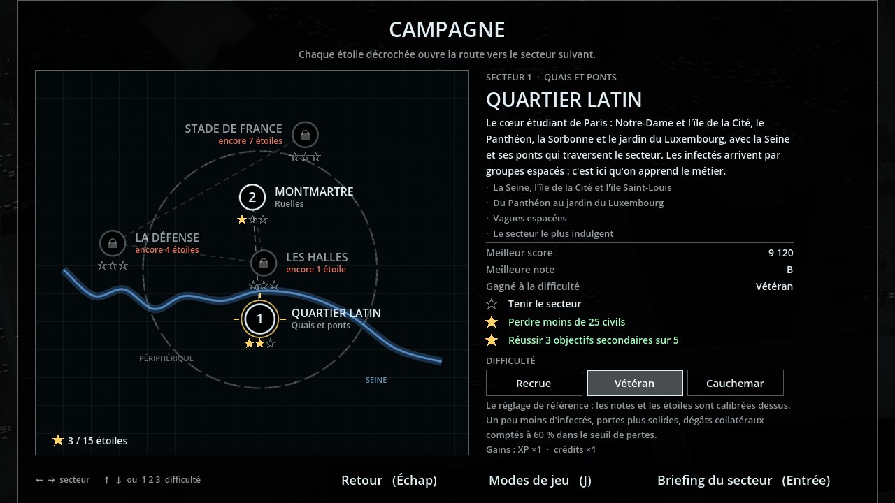

| Secteur | Ouvert à | Durée | Ce qui le distingue |
|---|---|---|---|
| **Quartier latin** (`mission_01`) | 0 étoile | 7 min | Notre-Dame, la Seine et ses îles, le Panthéon, le jardin du Luxembourg ; vagues espacées, seuil de pertes le plus large : le secteur d'apprentissage |
| **Montmartre** (`mission_02`) | 2 étoiles | 7 min | la butte du Sacré-Cœur, Pigalle, jusqu'à la gare du Nord : ruelles de 6 à 8 m entre des immeubles serrés, où un obus de 105 mm fait des dégâts en chaîne ; nombreux assauts sur les portes |
| **Les Halles** (`mission_03`) | 4 étoiles | 7 min | le Forum des Halles, Saint-Eustache, Beaubourg, le Louvre : quartier très dense, presque sans parc ; huit bouches de métro, toutes de vraies stations, d'où surgissent des groupes (vague `metro`, annoncée par la radio, bouches repérées en bleu sur la vue et sur la carte tactique ; les quatre autres secteurs ont aussi leurs groupes du métro) |
| **La Défense** (`mission_04`) | 7 étoiles | 7 min 30 | la Grande Arche et des tours de plus de 100 m qui masquent les tirs, jusqu'à 24 civils par tour, portes d'autant plus solides que l'immeuble est peuplé, plus de coureurs |
| **Stade de France** (`mission_05`) | 10 étoiles | 8 min | le stade de Saint-Denis et le canal, avec quatre tribunes de 70 à 100 civils ; les assauts visent les tribunes et un obus lourd sur l'une d'elles coûte une grande part du seuil de pertes |

**Carte de campagne.** Touche K au briefing et au débriefing : une carte stylisée de la capitale (nord en haut, périphérique, Seine,
secteurs reliés par une courbe, étoiles gagnées et cadenas sur les secteurs fermés) et, à droite, la fiche du secteur choisi :
description, particularités, meilleur score, meilleure note, plus haute difficulté gagnée, conditions d'étoiles. ← → ou Tab
changent de secteur, ↑ ↓ ou 1 2 3 la difficulté, Entrée ouvre le briefing du secteur (un double-clic sur un secteur aussi), Échap
revient. Un secteur fermé dit combien d'étoiles il manque. Au débriefing, le jeu annonce le secteur que le résultat vient
d'ouvrir, ou ce qu'il reste à gagner pour le prochain. Le jeu reprend au dernier secteur joué.

**Difficultés** (`data/difficulty.json`). Choisies au briefing (boutons, ou ↑ ↓) ou sur la carte. La mission d'origine n'est jamais
modifiée : le jeu en fabrique une copie transformée au lancement (`Campaign.apply_difficulty` dans `scripts/meta/campaign.gd`).
Les nombres que la radio doit prononcer (infectés à neutraliser, taille des groupes) sont arrondis aux valeurs que la voix sait dire.

| | Recrue | Vétéran | Cauchemar |
|---|---|---|---|
| Effectif des vagues, des assauts, des renforts et des objectifs de chasse | ×0,7 | ×0,8 | ×1 |
| Infectés présents au départ | ×0,7 | ×0,8 | ×1 |
| Seuil de civils perdus | ×1,6 | ×1,35 | ×1 |
| Points de vie des infectés | ×0,8 | ×0,9 | ×1 |
| Part de coureurs | ×0,3 | ×0,6 | ×1 (plafonnée à 70 %) |
| Résistance des portes | ×1,6 | ×1,4 | ×1,1 |
| Durée d'un repas des infectés enfermés avec des civils (civils dévorés plus lentement) | ×1,6 | ×1,25 | ×1 |
| Répit avant le premier repas d'un immeuble envahi (le temps de voir l'alerte et de tirer à la porte) | 14 s | 8 s | aucun |
| Part des civils tués par vos propres tirs qui compte dans le seuil de pertes | 50 % | 60 % | 100 % |
| Indicateur de chute des obus lourds | oui | oui | **non** |
| Viseur attiré vers la zone urgente (voir « Savoir quoi faire maintenant ») | **oui** | non | non |
| Carrés rouges sur les infectés cachés derrière un immeuble, et tirs guidés (voir « Zone réduite… (lot 8) ») | **oui** | **oui** | non |
| XP / crédits gagnés | ×0,7 / ×0,8 | ×1 / ×1 | ×1,6 / ×1,4 |

Le score, les étoiles et les médailles comptent toujours *tous* les civils tués par vos tirs : seul le seuil de défaite est plus
indulgent (le briefing l'indique). Ces niveaux ont été **assouplis en novembre 2026** (retour « le jeu est un peu trop difficile ») :
Vétéran n'est plus le réglage brut des missions mais un réglage un peu allégé, et Cauchemar reprend à peu près l'ancien Vétéran. Un
second retour (25 novembre : « encore trop difficile, je perds des civils sans comprendre pourquoi ») a ajouté les repas plus lents, le
répit avant le premier repas, Recrue par défaut tant qu'on n'a rien gagné, et surtout l'explication des pertes (voir « Comprendre les pertes
et savoir quand raser »).

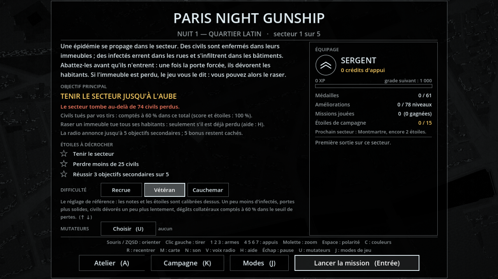

Tant qu'on n'a gagné aucune mission, le jeu propose Recrue, sauf si l'on a choisi soi-même une autre difficulté (au briefing, sur la carte
ou pour un mode) ; après une première victoire il reprend le dernier niveau joué (Vétéran par défaut). Une difficulté enregistrée par une
ancienne version, sans que le joueur l'ait choisie, est donc ignorée jusqu'à la première victoire. Vétéran est le
réglage de référence : les seuils de note et les conditions d'étoiles sont calibrés dessus (avec un robot seulement, voir
« Équilibrage »). Les notes et les étoiles ne changent pas avec la difficulté, mais la mission, elle, devient plus facile ou plus
dure. La fiche de chaque secteur garde la plus haute difficulté gagnée, et deux médailles y sont liées (gagner en Vétéran ou plus,
gagner en Cauchemar).

**Ajouter un secteur.** Copier un `data/mission_0X.json`, changer sa clé `city` (`file` : nom d'un fichier de `data/cities/` ; ou, pour une ville générée, `seed`, `size`, `style` : `latin`,
`montmartre`, `halles`, `defense` ou `stade`), ses vagues, ses objectifs et ses seuils, puis ajouter une entrée à `data/campaign.json` (`id`,
`file`, `name`, `tag`, `map` : position [x, y] de 0 à 1 sur la carte, `unlock`, `text`, `features`). Réglages utilisés par les
secteurs les plus durs :

- vague `metro` : `count`, `r_min` et `r_max` (distance de la bouche de métro au centre d'orbite) ;
- vague `assault` : `min_occ` (habitants minimum de l'immeuble visé) et `min_aim` (distance minimale à la visée, en mètres) ;
- vague `breach` : `max_occ` (habitants maximum, 30 par défaut, pour qu'une brèche n'expose pas des dizaines de civils) ;
  clé de mission `start_max_occ` (16 par défaut) pour l'immeuble déjà infesté au départ ;
- règles `door_big_free` (40 par défaut) et `door_big_div` (100) : au-delà de `door_big_free` habitants, la porte tient plus
  longtemps (un `door_big_div`-ième de plus par habitant en trop) ;
- les immeubles hauts ont plus de points de vie, jusqu'au double de ceux d'un immeuble de 22 m (`HP_TALL_MAX` dans
  `scripts/sim/building_system.gd`).

## Infectés spéciaux

Trois types d'infectés s'ajoutent aux infectés ordinaires (`data/zombies.json`). Ils arrivent par des vagues `special` dans les
secteurs 2 à 5, et par le calendrier de la Nuit blanche. À l'écran, un losange avec le nom et la distance les désigne (le colosse y
ajoute une jauge de vie) ; une flèche au bord de l'écran montre le plus proche quand il est hors champ ; la radio les annonce avec la
direction et la distance. Un infecté spécial abattu rapporte ses points de base, multipliés par la série.

| | Colosse | Hurleur | Alpha |
|---|---|---|---|
| Points de vie de référence (multipliés par ceux de la difficulté) | 780 | 34 | 290 |
| Vitesse (m/s) | 0,95 à 1,25 | 1,7 à 2,2 | 2,5 à 3,1 |
| Taille | ×1,7 | ×0,97 | ×1,18 |
| Part des dégâts qui passe (25 mm / 40 mm / 105 mm) | 4 % / 30 % / 100 % | 100 % | 50 % / 80 % / 100 % |
| Coups portés à une porte | ×4,5 | ×1 | ×2 |
| Points de base | 300 | 90 | 160 |
| Particularité | seul le 105 mm en vient à bout vite ; il enfonce les portes | toutes les 7 s il hurle : les infectés à moins de 170 m courent 1,7 fois plus vite pendant 5 s | mène une meute de 5 à 8 infectés, 1,3 fois plus rapides ; s'il tombe, la meute s'égaille pendant 4,5 s |

Le hurleur est fragile mais il rend tout le reste plus dangereux : mieux vaut l'abattre en premier. L'alpha, blindé à moitié contre le
25 mm, se traite au 40 mm. Une vague spéciale se décrit ainsi, dans la liste `waves` d'un secteur :

```json
{"t": 180, "type": "special", "zt": "colossus", "count": 1, "r_min": 175, "r_max": 450}
```

`zt` vaut `colossus`, `screamer` ou `alpha` ; `r_min` et `r_max` bornent la distance au centre de l'orbite (et restent dans la zone de jeu : 450 m au plus pour les infectés spéciaux). Toute vague (spéciale ou non)
peut porter `"min_level": 1` (0 Recrue, 1 Vétéran, 2 Cauchemar) : elle n'existe alors qu'à partir de cette difficulté. Répartition actuelle :

| Secteur | À toutes les difficultés | Vétéran et Cauchemar seulement (`min_level` 1) |
|---|---|---|
| Quartier latin | aucun (le secteur d'apprentissage) | aucun |
| Montmartre | hurleur à 150 s et à 300 s | aucun |
| Les Halles | aucun | hurleur à 110 s ; alpha à 210 s et à 310 s |
| La Défense | aucun | hurleur à 90 s ; colosse à 180 s et à 360 s ; alpha à 270 s |
| Stade de France | colosse à 110 s et à 310 s ; hurleur à 240 s ; alpha à 390 s | aucun |

**Pourquoi pas en Recrue aux secteurs 3 et 4.** Ces deux secteurs étaient déjà les plus serrés en Recrue pour le robot d'essai
(voir « Équilibrage »), et les spéciaux y retiraient beaucoup de victoires : sur les mêmes 32 graines, le robot gagnait 44 % des parties
du secteur 3 sans spéciaux contre 9 % avec, et 56 % contre 28 % au secteur 4. Au secteur 5 (72 % contre 62 %) et au secteur 2, l'écart
était faible : les spéciaux y restent. **Ces mesures datent des anciennes villes générées** ; elles n'ont pas été refaites sur les
cartes réelles, où la répartition ci-dessus a simplement été conservée. La mesure est celle d'un robot sans visée anticipée, qui
n'utilise aucun appui ; un joueur humain fera sans doute mieux, mais personne n'a joué ces niveaux. Si les débutants trouvent les
secteurs 3 et 4 trop faciles sans spéciaux, il suffit de retirer `min_level` dans `data/mission_03.json` et `data/mission_04.json`.

Les armes ne sont pas ajustées contre eux au hasard : le blindage (`armor`, trois valeurs pour 25 mm, 40 mm et 105 mm) est dans le
fichier de données, avec la portée et la durée des hurlements (`every_s`, `radius_m`, `frenzy_s`, `speed_mult`) et la taille des
meutes (`pack`, `pack_speed`, `panic_s`).

## Appuis ponctuels

Quatre appuis s'achètent à l'atelier (rubrique APPUIS, trois niveaux chacun) et s'appellent à la radio avec les touches **4 à 7**, sur
le point visé à cet instant (`data/supports.json`). Chaque niveau fixe le nombre d'appels par mission et le délai entre deux appels. La barre
en bas de l'écran montre pour chaque appui acheté son état : PRÊT, délai restant, EN COURS, ÉPUISÉ. Un appel impossible (non acheté,
plus d'appel, en recharge, aucune rue à proximité pour le leurre) est refusé à la radio avec la raison.

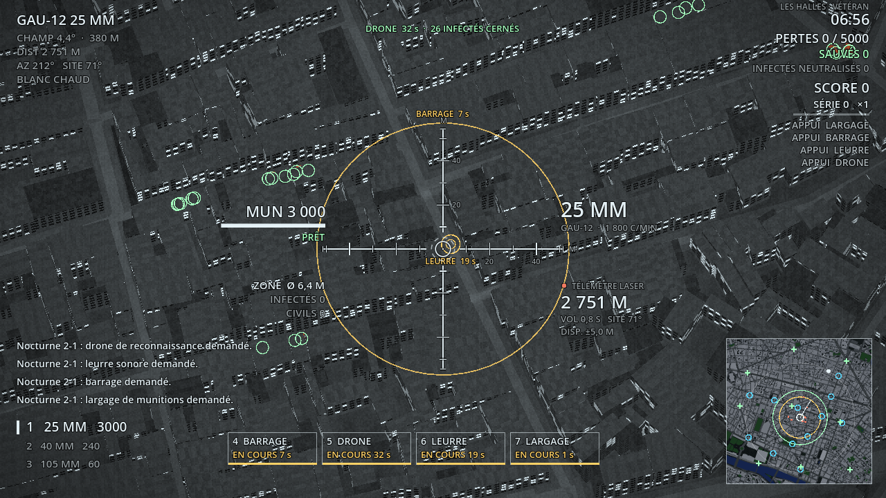

| Appui | Touche | Effet | Niveaux 1 / 2 / 3 |
|---|---|---|---|
| Barrage d'obusiers | 4 | une salve de 105 mm tombe au hasard dans un cercle autour du point visé, de 6 à 9,5 s après l'appel | 5 / 7 / 9 obus sur 48 / 54 / 60 m de rayon ; 1 / 2 / 3 appels, 75 / 60 / 45 s de délai |
| Drone de reconnaissance | 5 | cerne les infectés de la zone et les immeubles qu'ils visent ; la carte montre sa zone | rayon 350 / 450 / 550 m pendant 25 / 35 / 45 s ; 1 / 2 / 3 appels, 60 / 50 / 40 s |
| Leurre sonore | 6 | les infectés des rues qui ne sont pas à une porte convergent vers le point visé | rayon 260 / 340 / 420 m pendant 15 / 22 / 30 s ; 1 / 2 / 3 appels, 50 / 45 / 40 s |
| Largage de munitions | 7 | 4 s plus tard, chaque arme retrouve une part de sa capacité | 50 / 75 / 100 % ; 1 / 2 / 2 appels, 90 / 80 / 70 s |

Les obus du barrage ne comptent ni parmi les coups tirés ni dans la précision ; leurs éliminations sont comptées à part. Le barrage ne
distingue pas les civils : comme tout obus de 105 mm, il compte comme bavure s'il en touche. Les trois niveaux d'un appui coûtent de
1 150 à 1 750 CA en tout.

**Pas de fusée éclairante.** Elle figurait dans la première liste d'idées. Elle a été remplacée par le largage de munitions :
l'imagerie thermique ne tire aucun profit d'un éclairage, la fusée n'aurait rien changé à ce que l'on voit.

## Mutateurs

Six variantes de règles se choisissent avant le départ (touche **U** au briefing, puis 1 à 6 pour en activer ou en retirer un ; trois au
plus à la fois). Chacune multiplie les gains d'XP et de crédits de la mission ; les bonus de plusieurs mutateurs se multiplient
(`data/mutators.json`, clés `bonus`, `excludes`, `effects`). Ils s'appliquent à la campagne et à la Nuit blanche ; le défi du jour
impose les siens. Les notes et les étoiles ne changent pas.

| Mutateur | Effet | Gains |
|---|---|---|
| Brouillard | la chaleur se perd avec la distance : il faut zoomer pour voir les personnes | +12 % |
| Panne radio | plus d'alerte ni d'objectif annoncé ; la carte tactique ne montre plus les infectés ni les immeubles attaqués | +20 % |
| Portes fragiles | les portes cèdent deux fois plus vite (incompatible avec Portes blindées) | +15 % |
| Portes blindées | les portes tiennent deux fois plus longtemps (incompatible avec Portes fragiles) | −10 % |
| Munitions rares | réserves ×0,6 et régénération ×0,5 | +15 % |
| Coureurs | deux fois plus d'infectés courent (plafond de 70 %) | +12 % |

## Défi du jour et Nuit blanche

Ces deux modes s'ouvrent après la **première victoire en campagne** (`unlock_wins` dans `data/modes.json`). On y accède par la touche **J**
au briefing, sur la carte de campagne et au débriefing : **D** lance le défi du jour, **N** la Nuit blanche ; ← → changent de secteur et
↑ ↓ (ou 1 2 3) de difficulté pour la Nuit blanche. Ils ne donnent ni étoile ni note de campagne.

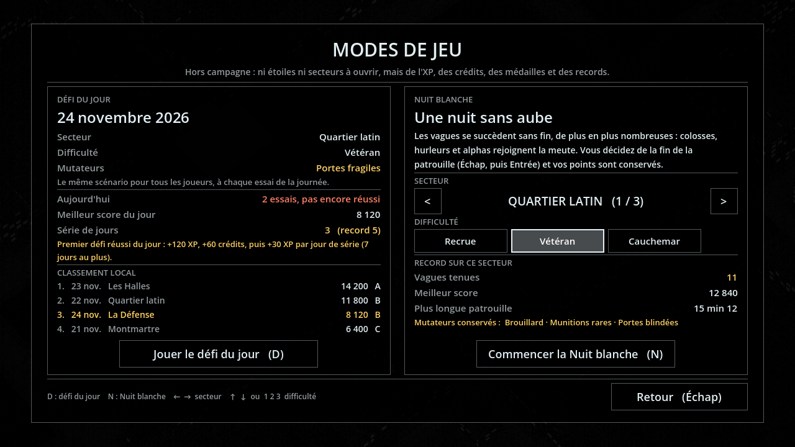

**Défi du jour.** Une date donne un scénario : le secteur, la graine de la ville, la graine des vagues et zéro à deux mutateurs sont
tirés de la date seule (date locale de la machine, texte `png-daily-AAAA-MM-JJ` haché en 32 bits), en difficulté Vétéran. Tous les
joueurs ont donc le même scénario le même jour, et chaque nouvel essai du jour refait le même. Le hasard des vagues a son propre
générateur, isolé du reste de la partie, pour que les mêmes vagues arrivent aux mêmes dates. Ce n'est pas un rejeu à l'identique :
les positions d'apparition sont mesurées depuis le centre de l'orbite et les immeubles visés par les assauts dépendent de l'état de la
partie, deux essais ne voient donc pas exactement les mêmes infectés aux mêmes endroits.

- Récompenses : une prime au **premier défi réussi** de la journée (120 XP, 60 CA), plus, à partir du deuxième jour consécutif, 30 XP
  et 15 CA par jour de série (7 jours au plus). La série continue si l'on a gagné la veille, sinon elle repart de un.
- Un **classement local** garde les dix meilleurs scores, parties perdues comprises, avec la date, le secteur et la note. Il est sur
  cette machine, dans le profil : il n'y a ni réseau, ni protection contre la triche.
- Un défi perdu rapporte une part des gains comme une mission perdue (40 % de l'XP, 50 % des crédits), sans prime ni série.
- Le défi du jour ne touche ni aux étoiles ni aux records des secteurs de la campagne.

**Nuit blanche** (mode sans fin). Le secteur choisi tient tant que l'on ne perd pas 60 civils ; les vagues sont engendrées à la volée et
durcissent avec le temps (`endless` dans `data/modes.json`) :

| Réglage | Valeur |
|---|---|
| Première vague | 25 s ; intervalle entre vagues de 30 s à 14 s en 13 min |
| Effectif d'une vague | de 7 à 30 infectés en 16 min |
| Vie des infectés | jusqu'à +100 % en 25 min ; part de coureurs de 20 % à 50 % |
| Assaut sur un immeuble | toutes les 3 vagues à partir de la 3e |
| Immeuble déjà infesté | toutes les 4 vagues à partir de la 4e |
| Bouche de métro | toutes les 3 vagues à partir de la 2e (sinon, vague de rue) |
| Hurleur / alpha / colosse | toutes les 4 vagues dès la 4e / toutes les 5 dès la 6e / toutes les 6 dès la 8e (un de plus toutes les quatre périodes) |
| Objectifs | ceux du secteur reviennent par cycles de 5 minutes |
| Notes | seuils C, B, A, S : 3 000, 8 000, 15 000, 26 000 |

Il n'y a pas de victoire : on joue le plus longtemps possible, ou l'on rend la main à l'équipage (Échap puis Entrée) en gardant son
score. Chaque vague tenue rapporte des points (60 pour la première, 15 de plus à chaque vague suivante). XP = 0,08 par point + 20 par
vague + 12 par minute ; crédits = 0,008 par point + 4 par vague + 3 par minute, avant les multiplicateurs de difficulté, de mutateurs et
d'équipage ; les objectifs réussis ajoutent leurs primes habituelles. Le jeu garde pour chaque secteur le meilleur score, la meilleure
vague et la plus longue durée. Seuls les secteurs ouverts peuvent être choisis. La difficulté et les mutateurs du briefing s'appliquent.

## Lire le viseur

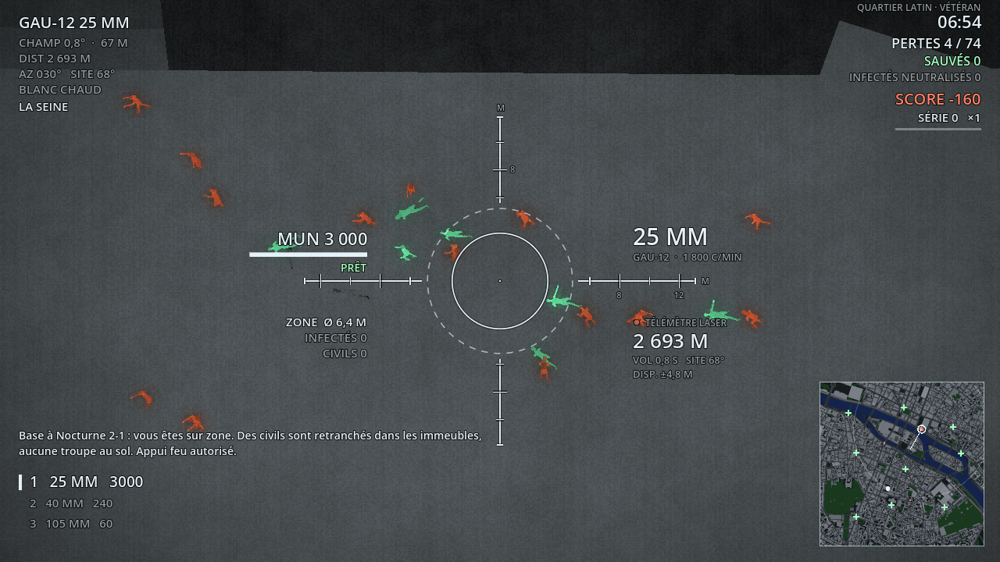

- **Branches graduées** : un trait par pas de terrain « rond » (1, 2, 5, 10, 20, 50 m...) mesuré depuis le point visé,
  avec les mètres écrits sur les branches droite et haute. La branche verticale tient compte du raccourci de perspective :
  elle est graduée en mètres *au sol*.
- **Cercle** : rayon d'éclat de l'arme. Son cadre dépend de l'arme : cercle nu pour le 25 mm, équerres pour le 40 mm,
  carré évidé pour l'obusier de 105 mm.
- **Cercle en pointillé** : dispersion des coups à la distance mesurée (un écart-type). À grande distance, le 25 mm
  s'étale plus largement que son propre rayon d'éclat.
- **Calibre** (en haut à droite du réticule) : « 25 MM », « 40 MM » ou « 105 MM », avec le nom de l'arme et la cadence.
- **Télémètre laser** (en bas à droite) : la distance oblique jusqu'au point touché, mise à jour à chaque image ; le
  point clignote à chaque mesure. Dessous : temps de vol de l'obus, angle de site (dépression de la ligne de visée) et dispersion en mètres.
- **Munitions** (en haut à gauche) : stock, jauge, et état de l'arme (PRÊT, TIR, RECHARGE, MUNITIONS ÉPUISÉES).
  Pour les armes lentes, un arc rouge se remplit autour du cercle pendant la recharge. Dans la liste des armes (en bas à gauche), une barre sous chaque arme qui
  se recharge montre où elle en est, même quand on tient une autre arme : changer d'arme n'attend jamais le rechargement de la précédente.
- **Zone d'effet** (en bas à gauche) : diamètre de la zone, nombre d'infectés et de civils qu'elle contient ; un message
  clignote si des civils s'y trouvent. Si la visée tombe sur un immeuble : hauteur, nombre d'habitants et d'infectés à l'intérieur.
- **Obus lourds en vol** (40 mm et 105 mm) : un losange marque le point de chute, entouré du rayon d'éclat en pointillé,
  avec le temps restant avant l'impact.
- En haut à gauche, le champ affiche aussi la largeur de terrain couverte par l'image.

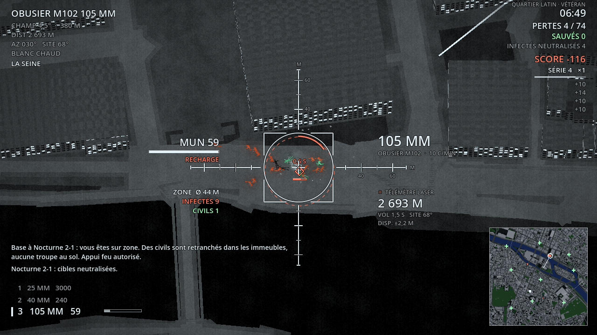

Le viseur reste lisible en noir chaud (encre sombre cerclée de blanc) :

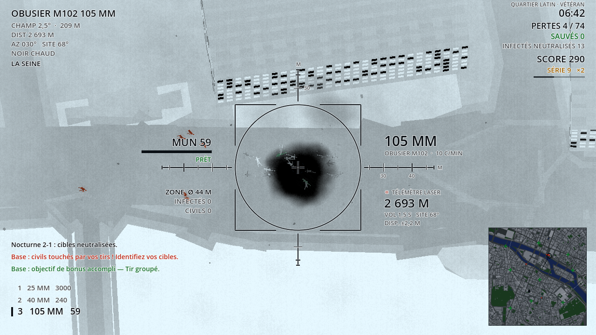

## Son et radio

Tout le son est fabriqué par des scripts Python (`tools/audio/`) : les armes sont synthétisées par calcul (aucune
bibliothèque de sons), les voix de la radio sont synthétisées puis déformées. Les fichiers produits sont dans `audio/`
(environ 10 Mo) et le jeu les lit au démarrage. Aucun son d'impact ni d'effondrement n'est joué : à plus de 2 500 m
d'altitude, on ne les entendrait pas.

**Armes** (réglages dans le bloc `sfx` de chaque arme de `data/weapons.json`) :

- **25 mm GAU-12** : 30 coups par seconde. Courte montée en régime, puis boucle d'une seconde sans couture tant que la
  détente est tenue, puis queue de la dernière détonation. Rafale = son continu à la cadence réelle de l'arme.
- **40 mm Bofors** : un coup par obus (3 variantes, hauteur et niveau légèrement tirés au hasard), puis claquement de
  culasse 0,3 s plus tard.
- **105 mm M102** : un coup par obus (2 variantes), puis, calés sur le temps de recharge, éjection de la douille,
  chargement et verrouillage de la culasse.
- **Sélecteur d'arme** (3 variantes) et **clic à vide** quand il n'y a plus de munitions.
- **Moteurs** : ronronnement de quatre turbopropulseurs en boucle de 8 s, très discret (bus Ambiance à −17 dB).

**Radio** (répliques dans `data/radio_script.json`, logique dans `scripts/core/radio.gd`) :

- **Trois intervenants** : LUTÈCE (station directrice, voix féminine à l'aspect « chiffré »), NOCTURNE 2-1 (l'avion,
  voix médium nasillarde d'interphone de cockpit) et TIREUR (voix grave étouffée par le masque à oxygène).
- Quand la partie le demande (nouveau groupe d'infectés, assaut ou intrusion dans un immeuble, porte forcée, civils
  touchés, immeuble détruit, seuils de pertes, fin de mission...), la radio compose un **échange** : la station
  annonce le nouvel objectif avec **le nombre, la direction (8 points) et la distance** mesurés depuis le point visé
  (« Au nord-est de votre visée, à sept cents mètres »), l'avion accuse réception, le tireur confirme. Les
  événements fréquents ont plusieurs variantes, jamais deux fois la même d'affilée.
- **File d'attente** : les alertes passent avant les nouvelles courantes, une réplique devenue trop vieille est
  abandonnée, une urgence (priorité supérieure d'au moins 3) coupe l'échange en cours après la phrase qui se termine, et
  les messages répétitifs ont un délai de garde. Pendant qu'une voix parle, le moteur et les armes baissent de quelques
  décibels pour garder les voix compréhensibles.
- **Voix « pas normales »** : voix de synthèse (Piper) dont la hauteur est décalée, passée dans un vocodeur à bandes
  (timbre de robot), limitée à la bande téléphonique, saturée, écrasée à 7-8 bits, avec souffle de liaison,
  micro-coupures et craquements ; déclic d'émission au début et à la fin de chaque phrase ; bruit de fond propre à chaque
  radio (grésillement et sifflement de la liaison, bourdonnement à 400 Hz de l'interphone, respiration dans le masque).
- La banque contient 425 phrases courtes (environ 8,2 Mo, 8 kHz) synthétisées une fois et **assemblées à la volée** : les
  nombres, les directions, les distances et les durées sont des morceaux interchangeables. Le script compte 47 types d'événement ;
  les explications de pertes (immeuble perdu à raser, porte attaquée, civils dévorés dans un immeuble ou dans la rue, immeuble perdu rasé),
  les infectés spéciaux (annonce du colosse, du hurleur et de l'alpha, de leur chute), les appels d'appui, les vagues de la Nuit
  blanche, la panne de la station (mutateur) et la fin de patrouille en font partie.
- Le journal radio affiche le texte de chaque phrase au moment où elle est dite. Sans son (`--nosound`) ou sans banque,
  les messages s'affichent seulement.

Touches : **N** coupe ou rétablit tout le son, **V** coupe les voix de la radio en gardant les armes.

**Régénérer ou modifier le son** (Python 3 ; les graines sont fixées, le résultat est le même d'une exécution à l'autre sur une même machine) :

```bash
pip install numpy scipy matplotlib piper-tts
python3 tools/audio/make_sfx.py                    # armes, moteurs, déclics : quelques secondes
python3 tools/audio/make_voices.py                 # voix : 2 à 3 minutes ; télécharge environ 130 Mo de modèles
                                                   # de voix dans tools/audio/models/ (ou --models DOSSIER)
python3 tools/audio/make_voices.py --check /tmp/controle   # + spectrogrammes et indicateur d'intelligibilité
python3 tools/audio/make_voices.py --reuse         # après avoir ajouté des répliques : ne synthétise que les phrases
                                                   # manquantes, les autres restent identiques à l'octet près
```

Ne pas utiliser l'option `-I` de Python : les scripts importent `dsp.py`, situé à côté d'eux.
Pour changer ce que dit la radio, modifier `data/radio_script.json` (intervenants, priorités, délais, variantes ;
un atome `"voix|affichage"` fait dire le premier texte et afficher le second ; `{dir}`, `{dist}`, `{n}` et `{civ}` sont
des valeurs insérées ; les objectifs ajoutent `{w}` et `{v}` : durée, civils, infectés, taille de groupe) puis relancer `make_voices.py`. Le caractère de chaque radio (hauteur, déformation, bruit) se règle
dans `PROFILES` de `tools/audio/make_voices.py`, le niveau des bus et l'atténuation pendant les voix dans `scripts/core/sound.gd`.

**Vérifier le son sans carte son** : le pilote automatique joue une séquence d'armes et de demandes radio, imprime la
chronologie et enregistre le mélange final.

```bash
godot --headless --path . -- --autopilot=sound --audio-log --audio-record=/tmp/mix.wav
# autres options : --audio-seconds=60 (quitte après 60 s), --nosound
```

**Crédits et licences des voix.** Les voix sont des modèles de [Piper](https://github.com/rhasspy/piper) (outil de
fabrication, utilisé hors du jeu, modèles de la version v0.0.2) : `fr-siwis-medium`, entraîné sur la base SIWIS de
l'université d'Édimbourg (<https://datashare.is.ed.ac.uk/handle/10283/2353>, licence **CC BY 4.0** : il faut citer
la source si vous diffusez le jeu avec ces voix), et `fr-gilles-low`, entraîné sur un jeu de données sous licence CC0
(Kaggle, « French Single Speaker Speech Dataset »). Piper est sous licence GPL-3.0 ; il n'est pas embarqué dans le jeu.

## Réglages

Tout se règle sans toucher au code :

- `data/weapons.json` : cadence, champ, dispersion, rayon d'éclat, dégâts, munitions, régénération, et pour le viseur
  `label` (nom court), `caliber_mm` (calibre affiché) et `reticle` (`circle`, `brackets` ou `square`), puis `sfx`
  (sons de l'arme : mode `burst` ou `single`, échantillons, gain en dB, sons de recharge datés en secondes).
- `data/radio_script.json` : la radio (voir « Son et radio »).
- `data/scoring.json` : barème du score (voir « Score, séries, étoiles et notes »).
- `data/progression.json`, `data/upgrades.json`, `data/medals.json`, `data/cosmetics.json` : grades, règles d'XP et de crédits,
  atelier, médailles et cosmétiques (voir « Progression, atelier et médailles »).
- `data/campaign.json` et `data/difficulty.json` : les secteurs de la campagne et les niveaux de difficulté (voir « Campagne,
  secteurs et difficultés »).
- `lock` (0 ou 1) dans chaque niveau de `data/difficulty.json` : carrés rouges sur les infectés cachés et tirs guidés (1 en Recrue et en Vétéran, 0 en Cauchemar ;
  constantes en tête de `scripts/core/lock.gd` et de `_draw_locks` dans `scripts/ui/hud.gd`).
- `assist` (0 à 1) dans chaque niveau de `data/difficulty.json` : force du viseur assisté (1 en Recrue, 0 ailleurs). Les constantes de la priorité sont en tête de
  `scripts/sim/priority.gd`, celles de l'aimant en tête de `scripts/core/assist.gd` ; la taille du texte est enregistrée dans le profil (`settings.text`, 0 à 2).
- `data/zombies.json`, `data/supports.json`, `data/mutators.json` et `data/modes.json` : infectés spéciaux, appuis, mutateurs, défi du
  jour et Nuit blanche (voir « Infectés spéciaux », « Appuis ponctuels », « Mutateurs » et « Défi du jour et Nuit blanche »).
- `data/mission_01.json` à `data/mission_05.json` (un fichier par secteur) : la ville (`city` : graine, taille, style), durée,
  seuil de pertes, orbite (rayon 800 à 1 200 m, altitude 2 500 à 3 000 m, vitesse 78 à 90 m/s selon le secteur : une orbite plus verticale
  laisse voir le fond des rues étroites), vitesse des événements, la liste des vagues
  (`streets`, `breach`, `assault`, `metro`, `special`), les règles (`rules` : points de vie des infectés, part de coureurs, résistance des
  portes…), l'objectif principal (`primary`), les objectifs (`objectives`, `max_active_objectives`), les seuils de note
  (`score_targets`) et les conditions d'étoiles (`stars`). Depuis le lot 8 : `zone` (`cx`, `cz`, `radius_m` : le disque jouable ; sans cette clé, toute la carte)
  et, dans `rules`, `seek_ratio` (part des infectés qui cherchent une porte, 0,3 ; 1 si la règle manque), `amb_target` (civils des rues présents en permanence),
  `amb_spawn_s` (secondes entre deux sorties d'immeuble), `amb_fear_m` (distance à laquelle un civil voit un infecté et fuit) et `amb_chase_m` (distance à
  laquelle un infecté poursuit un civil).

Types de vagues :

- `streets` : des grappes de 3 à 6 zombies dans les rues, dans un anneau autour de l'orbite.
- `assault` : un groupe de zombies arrive sur la porte d'un immeuble, dont le siège est déjà partiellement avancé.
- `breach` : un immeuble est déjà infesté.
- `metro` : un groupe de `count` infectés sort d'une bouche de métro de la zone, choisie entre `r_min` et `r_max` du centre d'orbite, et erre ensemble dans les rues ; la radio le signale.
- `special` : un infecté spécial (`zt` : `colossus`, `screamer` ou `alpha`, `count`, `r_min`, `r_max`) ; voir « Infectés spéciaux ».

Toute vague peut porter `"min_level"` (0 Recrue, 1 Vétéran, 2 Cauchemar) : elle est retirée aux difficultés inférieures.

Au chargement, `scripts/meta/defs.gd` vérifie seulement que chaque fichier existe et se lit (sinon le jeu s'arrête avec un message).
La cohérence des valeurs (identifiants connus, conditions de médailles bien formées, durées et nombres que la radio sait prononcer,
seuils croissants, vagues valides) est contrôlée par les tests : relancez-les après toute modification des données
(`godot --headless --path . -s tests/sim_test.gd`).

**Équilibrage.** Les chiffres viennent d'un robot d'essai simple (`tests/sim_test.gd`) : il vise la grappe visible la plus dense ou
l'immeuble le plus menacé sans anticiper le déplacement des cibles, choisit l'arme qui convient aux infectés spéciaux, rase un immeuble
quand le conseil RASER est OUI (la règle du joueur, voir « Comprendre les pertes ») et n'utilise ni appui ni désignateur. **Il ignore les
carrés rouges et les obus guidés** : il vise lui-même ce qu'il voit. On ne sait pas comment il se compare à un humain, personne n'ayant
joué ces niveaux. Chaque case donne le nombre de victoires sur 32 parties (graines 9000 + 31·i : `--bots=32 --seed0=9000`) et la durée
moyenne d'une partie (une victoire compte pour l'instant où elle est prononcée, à l'aube ou plus tôt quand plus aucun infecté n'est détecté ;
une défaite pour l'instant de la défaite). Mesures du 26 novembre 2026, **sur les cartes réelles, avec la zone de 600 m, les infectés errants
et les civils des rues du lot 8** ; entre parenthèses, les victoires du même robot sur les mêmes graines le 25 novembre, avant le lot 8 :

| Secteur | Recrue | Vétéran | Cauchemar |
|---|---|---|---|
| Quartier latin | 32 / 32 · 395 s (31) | 32 / 32 · 398 s (31) | 32 / 32 · 403 s (6) |
| Montmartre | 32 / 32 · 389 s (30) | 32 / 32 · 395 s (23) | 31 / 32 · 401 s (3) |
| Les Halles | 32 / 32 · 398 s (32) | 32 / 32 · 403 s (28) | 29 / 32 · 400 s (0) |
| La Défense | 30 / 32 · 436 s (26) | 24 / 32 · 421 s (13) | 11 / 32 · 317 s (4) |
| Stade de France | 32 / 32 · 459 s (28) | 32 / 32 · 462 s (17) | 24 / 32 · 453 s (4) |

Civils perdus par partie, en moyenne sur les mêmes 32 parties (civils des immeubles et civils des rues ; entre parenthèses, le seuil de
défaite du niveau, au-delà duquel le secteur tombe) :

| Secteur | Recrue | Vétéran | Cauchemar |
|---|---|---|---|
| Quartier latin | 9,0 (88) | 11,8 (74) | 22,3 (55) |
| Montmartre | 9,7 (83) | 14,2 (70) | 25,6 (52) |
| Les Halles | 20,1 (112) | 25,0 (94) | 48,8 (70) |
| La Défense | 65,9 (128) | 78,8 (108) | 73,4 (80) |
| Stade de France | 11,0 (136) | 14,8 (115) | 36,7 (85) |

Avant l'assouplissement du 24 novembre et avec les anciennes villes générées, le même robot gagnait 44 à 91 % des parties en Recrue, 0 à
19 % en Vétéran et jamais en Cauchemar. Pour repère, un joueur qui ne fait rien perd un secteur en 218 à 334 s en Vétéran (option `--idle` ;
174 à 251 s le 25 novembre, avant le lot 8 ; 163 à 233 s le 24 novembre ; 107 à 148 s avant l'assouplissement). À retenir :

- **Troisième retour (26 novembre) : « c'est mieux mais pas suffisant ».** Le robot gagne maintenant **toutes ses parties en Recrue et en
  Vétéran dans quatre secteurs sur cinq** (à La Défense : 30 et 24 sur 32), contre 26 à 32 sur 32 en Recrue et 13 à 31 en Vétéran le
  25 novembre : **le jeu est nettement plus facile**, et ce n'est pas l'effet des carrés rouges ni des obus guidés, que le robot n'utilise pas. Je n'ai pas
  isolé la part de chaque changement du lot 8. Le seul essai qui en isole un (Cauchemar, Quartier latin, 16 parties) : faire chercher une porte à tous les infectés
  (au lieu de 3 sur 10) ne le rend pas plus difficile (14 victoires sur 16, contre 16 sur 16 avec 3 sur 10 pour les mêmes graines), ce qui laisse les autres changements
  comme explications possibles, sans preuve : la zone plus petite (cibles plus proches et plus denses, un obus en touche davantage), les infectés qui errent
  au lieu de forcer les portes, les civils des rues qui servent d'appât. En Recrue et en Vétéran, les pertes moyennes sont à moins de 30 % du seuil
  (deuxième tableau), sauf à La Défense (51 % et 73 %). Ce que cela donne pour un humain est inconnu.
- **Le Cauchemar n'est plus difficile pour le robot** : 32, 31, 29, 11 et 24 victoires sur 32 (Quartier latin, Montmartre, Les Halles,
  La Défense, Stade de France) contre 6, 3, 0, 4 et 4 le 25 novembre. Je ne l'ai pas durci, la demande allant dans l'autre sens. Un essai de réglage
  sur une copie de travail, non conservé dans le projet (Quartier latin, 16 parties par essai, mêmes graines), montre qu'un simple multiplicateur ne suffit
  pas : avec 1,6 à 2 fois plus d'infectés et un seuil de pertes réduit de 25 à 40 %, le robot y gagne encore 7 à 9 parties sur 16. Pour le durcir, ce sont
  les clés `waves`, `start`, `lost` et `hp` du niveau « nightmare » de `data/difficulty.json`, mais `_test_campaign` suppose que le Cauchemar est la mission
  telle qu'écrite (multiplicateurs à 1, quota de 55 pertes au secteur 1) : il faudra l'adapter.
- **Ce que les tests imposent.** À partir de 16 parties (`--bots=16`), le robot doit gagner au moins une partie et perdre des civils (« la mission a des
  enjeux ») ; l'ancien « la mission n'est pas triviale » (au moins une défaite) a été retiré : il aurait échoué sans qu'aucun code soit en cause. En
  dessous (de 4 à 15 parties) : une victoire, ou une partie tenue 70 % du temps. Les autres cases sont des repères, pas des objectifs.
- **Avant le lot 8 (25 novembre)**, le robot gagnait presque toujours en Recrue (81 à 100 % des parties selon le secteur), le plus souvent en
  Vétéran sauf à La Défense (41 %) et au Stade de France (53 %), et rarement en Cauchemar (0 à 19 %).
- **Deuxième retour (25 novembre) : « encore trop difficile, je perds des civils sans comprendre pourquoi ».** Le robot ne lit pas l'écran :
  le bandeau des pertes, le conseil RASER, les explications à la radio et le détail du bilan, qui sont l'essentiel de ce qui a été ajouté,
  n'ont aucun effet sur ses résultats, et rien ne dit qu'ils suffiront à un humain. Ce qui change pour lui : les repas plus lents, le répit et
  la règle de rasage. Sur les mêmes graines, il gagne en Vétéran 31, 23, 28, 13 et 17 parties (Quartier latin, Montmartre, Les Halles,
  La Défense, Stade de France) contre 29, 19, 25, 10 et 17 le 24 novembre, et en Recrue 31, 30, 32, 26 et 28 contre 32, 29, 31, 21 et 25 :
  un gain petit, du même ordre que le bruit d'une mesure sur 32 parties (deux à trois victoires). Le Cauchemar, inchangé, est à peu
  près où il était : 6, 3, 0, 4 et 4 victoires contre 9, 5, 0, 5 et 3.
- **Pourquoi les niveaux ont été assouplis (novembre 2026).** Le retour était « un peu trop difficile ». Sur les cartes réelles, plus
  denses, le robot ne gagnait presque plus (en Recrue : 1 partie sur 16 à Montmartre, 0 sur 16 aux Halles). Ce qui a été mesuré, un
  levier à la fois sur les mêmes graines : (1) des immeubles de 20 m en bordure de rues de 8 à 15 m masquent les tirs ; une orbite plus
  verticale (rayon de 800 à 1 200 m, altitude de 2 500 à 3 000 m au lieu de 1 300 à 1 700 m et 2 000 à 2 400 m) fait passer Montmartre
  de 1 à 9 victoires sur 16 en Recrue, à elle seule ; (2) les portes sont à quelques mètres de la rue, les infectés les atteignent presque
  aussitôt : portes plus solides ; (3) les frappes sur un immeuble coûtent des civils : les dégâts collatéraux ne comptent que
  partiellement dans le seuil de pertes ; (4) les tribunes du Stade (240, 240, 160 et 160 civils) faisaient tomber le secteur dès
  qu'un assaut en forçait une : elles ont 100, 100, 70 et 70 civils, des portes plus solides, et l'anneau de service est à 28 m (au lieu de
  13 m) pour que l'ombre des tribunes ne cache plus les portes. Avec en plus des vagues réduites de 10 % et un seuil de 85 civils, le Stade
  passe de 28 % à 53 % de victoires en Vétéran.
  Essayés puis abandonnés : réduire la hauteur des tours pour les tirs (aucun effet à La Défense) et rendre les tours plus fragiles.
- La Défense reste le secteur le plus dur de la campagne. D'après les traces du robot, il y perd sur des immeubles de 12 à 26 civils
  infestés qu'il ne sait pas sauver autrement qu'en les détruisant ; les vagues y ont été réduites de 15 % et le seuil porté à 80 civils.
  Il y gagne 24 parties sur 32 en Vétéran depuis le lot 8 (13 le 25 novembre), 30 en Recrue et 11 en Cauchemar ; il y perd en moyenne 79 civils par
  partie en Vétéran pour un seuil de 108.
- Le robot ne voit que ce que la vraie caméra voit : dans la zone de 600 m de chaque secteur, 78 à 97 % des rues et 29 à 49 % des portes
  sont visibles depuis l'orbite en moyenne (option `--vis`, mesure du 26 novembre ; 76 à 96 % et 30 à 44 % sur 800 m autour du centre d'orbite le 25 novembre). Les infectés spéciaux n'ont pas été remesurés sur les cartes réelles (sur les anciennes
  villes, ils coûtaient 4 à 8 % de durée moyenne en Vétéran et faisaient chuter les victoires en Recrue aux secteurs 3 et 4, d'où le
  champ `min_level`, voir « Infectés spéciaux »).
- Les seuils de note de chaque secteur (`score_targets` ; 3 000 / 5 500 / 8 500 / 12 000 au Quartier latin) ont été estimés **avec ce
  robot seulement** : au Quartier latin en Vétéran, une victoire de robot donne le plus souvent un B (24 victoires sur 32 ; 5 A, 2 C, 1 D ; 2,8 étoiles
  en moyenne le 26 novembre contre 2 avant le lot 8). Ils sont à régler avec de vrais joueurs.
- Pour mesurer une modification : `godot --headless --path . -s tests/sim_test.gd -- --botsonly --bots=32 --sector=mission_03
  --level=recruit --seed0=9000`, en gardant les mêmes graines (`--seed0`) pour comparer deux versions d'un secteur, et au moins 32
  parties : à 16 parties l'écart type d'un taux de victoire dépasse 10 points. Une partie de 32 robots dure 2 à 4 minutes sur deux cœurs.

## Organisation du code

```
project.godot            projet Godot (rendu Compatibility, 1280x720)
scenes/main.tscn         scène unique, tout est construit par le code
data/cities/             les cinq cartes réelles (format pnc-city-2)
data/                    armes, radio, score, progression, atelier, médailles, cosmétiques, campagne (campaign.json), difficultés
                         (difficulty.json), infectés spéciaux (zombies.json), appuis (supports.json), mutateurs (mutators.json),
                         défi du jour et Nuit blanche (modes.json) et une mission par secteur (mission_01.json à mission_05.json)
audio/                   sons d'armes (sfx/) et banque de voix radio (radio/), produits par tools/audio/
docs/                    captures d'écran illustrant ce fichier (produites par le pilote automatique et le banc d'essai)
tools/city/              convertisseur des cartes réelles : make_city.py, landmarks.py, rezone.py (points d'évacuation et bouches de métro dans la zone de jeu), README.md
                         (outils de développement, pas lus par le jeu)
tools/audio/             générateurs : make_sfx.py, make_voices.py, dsp.py (outils de développement, pas lus par le jeu)
shaders/                 rendu thermique : sol, immeubles, personnages, particules d'explosion (éclats, étincelles,
                         fumée, boule de feu), traçantes, post-traitement
scripts/main.gd          assemblage, états de jeu, entrées
scripts/ctx.gd           contexte partagé (pas d'autoload)
scripts/world/           ville : données (formats pnc-city-1 et 2), générateur de secours (cinq styles : latin, montmartre, halles, defense, stade),
                         graphe routier, rendu,
                         maillage de personnage (human_mesh.gd : 13 os, accessoires)
scripts/sim/             simulation : immeubles, foule (dont les infectés spéciaux et le leurre sonore), réalisateur (vagues, règles,
                         calendrier de la Nuit blanche), priorité du moment (priority.gd : ce qu'il faut faire maintenant)
scripts/meta/            score.gd (points, séries, étoiles, notes), objectives.gd (objectifs), defs.gd (chargement et validation des
                         données de progression et de campagne), profile.gd (profil : XP, grades, crédits, atelier, médailles,
                         cosmétiques, records par secteur, sauvegarde), upgrades.gd (effets des améliorations : armes modifiées et
                         réglages « mod »), campaign.gd (déblocage des secteurs, choix du secteur et de la difficulté, copie de la
                         mission transformée par la difficulté), mutators.gd (mutateurs : mission, armes, gains), daily.gd (défi du
                         jour : scénario tiré de la date, série)
scripts/core/            canonnière, armes et obus, effets (fx.gd) et particules sans état (particle_set.gd),
                         son (sound.gd : bus, armes, moteurs, enregistrement) et radio (radio.gd : file d'attente, échanges),
                         predictor.gd (prédicteur de tir), designator.gd (désignateur laser), supports.gd (appuis : barrage, drone,
                         leurre, largage), assist.gd (viseur assisté de la Recrue), lock.gd (infectés cachés : carrés rouges et obus guidés)
scripts/ui/hud.gd        réticule gradué, télémètre, compteurs, carte, radio, repères d'objectifs
scripts/ui/screens.gd    briefing (carte de l'équipage), aide, pause, débriefing (3 pages), construits avec des contrôles Godot
scripts/ui/hangar.gd     atelier : améliorations, médailles, personnalisation
scripts/ui/campaign_view.gd  carte de campagne : secteurs, étoiles, fiche du secteur, choix de la difficulté
scripts/ui/mutators_view.gd  écran des mutateurs (touche U au briefing)
scripts/ui/modes_view.gd     écran du défi du jour et de la Nuit blanche (touche J)
scripts/ui/ui_kit.gd     thème, étoiles, icônes de résultat, boutons, insignes, médailles, barre d'XP, aperçus de réticule et de voix
scripts/dev/autopilot.gd pilote automatique pour captures et essais
tests/sim_test.gd        tests logiques sans affichage
tests/viewer.gd          banc d'essai des personnages : planches de marche, course, variété, états, tour complet
scripts/dev/export_check.gd  contrôle d'un export : données, sons et shaders présents dans le paquet (lancé par la compilation)
export_presets.cfg       préréglages d'export Windows, Linux et macOS (version, icône, filtres de fichiers)
.github/workflows/       compilation chez GitHub : essais, exports, .deb, .dmg, Release sur étiquette (+ actions/setup-godot)
tools/release/           build_deb.sh : assemble le paquet Debian
packaging/               fichiers des paquets : stryge.desktop (Linux), LISEZMOI.txt (image .dmg)
LICENSE, THIRD_PARTY_NOTICES.md  licence MIT du projet ; licences des données et composants tiers
```

La simulation est séparée de l'affichage : les tests tournent sans rendu.

## Personnages et explosions : principe

- **Personnages.** Un seul modèle humanoïde d'environ 450 triangles, dessiné en un seul appel pour toute la foule
  (jusqu'à 1 024 personnages). Le squelette est animé par le shader (marche ou course selon la vitesse réelle,
  boitement, siège de porte, repas, chute, relèvement) : aucune animation n'est calculée par le processeur.
  Chaque personnage a sa taille, sa démarche et son déphasage.
- **Teintes.** Le rendu 3D code le type du personnage dans les canaux de couleur ; le post-traitement le décode et
  applique la teinte, y compris dans le halo lumineux, pour qu'un zombie reste repérable même au milieu d'un incendie.
- **Explosions.** Éclats, étincelles, bouffées de poussière et de fumée sont des particules « sans état » : leur position
  est recalculée à chaque image par le shader à partir de leur date de naissance, sans coût par particule côté
  processeur. Les éclats rebondissent deux fois sur le sol, se refroidissent et disparaissent ; la fumée est portée
  par le vent et monte avec la chaleur. Un immeuble détruit s'affaisse en penchant, soulève un nuage de poussière,
  puis laisse des gravats irréguliers parsemés de braises qui s'éteignent en une minute environ.

## Formats de ville `pnc-city-1` et `pnc-city-2`

Coordonnées en mètres, X vers l'est, Z vers le sud, origine au centre du secteur (2 400 m de côté pour les cinq secteurs ; la partie n'en joue que le disque
de 600 m de rayon de la clé `zone` de la mission).

**`pnc-city-1`** (villes générées, ou fichier fait à la main) :

```json
{
  "format": "pnc-city-1",
  "nodes":     [[x, z], ...],
  "edges":     [[a, b, largeur, classe], ...],
  "buildings": [[cx, cz, largeur, profondeur, lacet, hauteur, habitants], ...],
  "areas":     [["park" | "water" | "evac", x0, z0, x1, z1], ...],
  "evac_nodes": [indices de nœuds]
}
```

Les portes des immeubles sont calculées au chargement (rue la plus proche). Les immeubles sont des **rectangles orientés** : les
contours polygonaux ne sont pas gérés. Pour écrire le fichier d'une ville générée : `CityData.save_json(chemin)` (voir
`scripts/world/city_data.gd`).

**`pnc-city-2`** (cartes réelles, `data/cities/*.json`, produites par `tools/city/make_city.py`) ajoute :

- `edges` : `[a, b, largeur, classe, drapeaux]`, classe 0 rue, 1 boulevard, 2 chemin sans trottoir ; le bit 0 des drapeaux marque un pont ;
- `mesh.water` et `mesh.park` : `{"v": [x, z, ...], "i": [indices de triangles]}`, des plans d'eau et des parcs de forme libre (la Seine,
  ses îles, le jardin du Luxembourg), triangulés à l'avance ;
- `doors` : pour chaque immeuble `[tronçon, x, z]`, la porte précalculée (le jeu en déduit la position le long du tronçon) ;
  les immeubles dont la porte serait à plus de 38 m d'une rue, ou mal reliée à la rue, sont sans habitants ;
- `places` : `[{"n": nom, "x", "z", "k": genre, "r": rayon}]`, les noms affichés sous la visée et sur la minicarte ;
- `metro_nodes` (8 bouches, dans la zone de jeu) et `meta` (nom, origine en longitude / latitude, sources et licences, `metro_names` : le nom de la station de chaque
  bouche, vide pour un simple carrefour, et `zone`). Les 9 `evac_nodes` forment une grille 3 × 3 resserrée autour du centre de la zone. Les deux listes sont
  produites par `tools/city/rezone.py` (voir « Zone réduite, rechargement par arme, infectés cachés, métro et rues »).

## Cartes réelles de Paris

Les cinq fichiers `data/cities/{quartier_latin,montmartre,halles,defense,stade}.json` sont fabriqués par `tools/city/` à partir de
trois sources de données **tierces** (extraits hébergés sur GitHub, lus en lecture seule) :

| Donnée | Origine | Licence |
|---|---|---|
| Bâtiments (emprises, hauteurs), monuments, eau | IGN, BD TOPO (extrait `nave20/foundry-wod-control-room`) | Licence Ouverte 2.0 |
| Rues, ponts, parcs, eau (Paris et La Défense) | OpenStreetMap (extrait `kik0s/paris-map-template`) | ODbL : © contributeurs OpenStreetMap |
| Stations de métro (lignes 1 à 6 et 14, données de 2016) | extrait `atom-84/fluctuat-nec-mergitur-d3` | aucune licence dans le dépôt : seules les positions des stations sont utilisées |

**Attribution à conserver si vous redistribuez le jeu** : « Données : IGN BD TOPO (Licence Ouverte 2.0) ; © contributeurs
OpenStreetMap (ODbL) ». Les fichiers JSON dérivés contiennent cette mention (`meta.sources`). Commits exacts, procédure de
régénération (`python3 tools/city/make_city.py`) et détail de la conversion : `tools/city/README.md`. Les licences n'ont pas été vérifiées
au-delà de ce que ces dépôts indiquent : à contrôler avant toute diffusion publique.

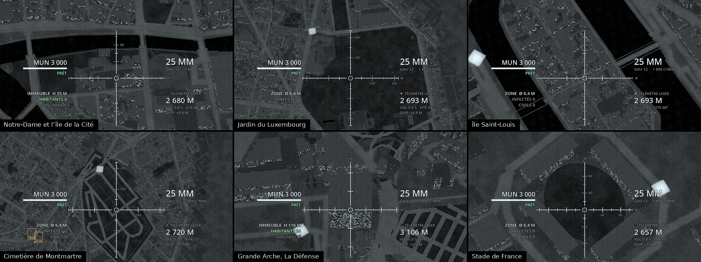

Le nom du lieu visé s'affiche sous la visée et sur la minicarte (scénario `places` du pilote automatique : un cliché par repère).

**Ce que la conversion approche ou invente**

- Les immeubles sont des rectangles orientés (un contour complexe devient plusieurs rectangles), aux toits plats, avec la hauteur de
  la BD TOPO.
- Les rues viennent d'OpenStreetMap dans Paris et à La Défense ; **au Stade de France et sur les bords de La Défense elles sont
  déduites des vides entre bâtiments** et ne sont pas les vraies rues. Un anneau de service est ajouté autour des tribunes.
- Les habitants sont calculés d'après la surface et le nombre d'étages, puis réglés par secteur pour l'équilibrage : ce sont des valeurs
  de jeu. Les tribunes du Stade de France ont 100, 100, 70 et 70 habitants (réglage de jeu, pas la capacité réelle).
- Les noms de lieux (`tools/city/landmarks.py`) sont écrits à la main ; un nom n'est gardé que si une donnée réelle existe à cet endroit.
- Les 9 points d'évacuation et les 8 bouches de métro de chaque secteur sont placés par `tools/city/rezone.py` dans la zone de jeu (disque de 600 m). Les bouches sont
  de vraies stations des lignes 1 à 6 et 14 quand la zone en contient (Les Halles : les 8 ; Quartier latin : 4 ; Montmartre : 4 ; La Défense : 2 ; Stade de France : aucune),
  complétées par de simples carrefours : ce sont des repères de jeu, pas un plan du métro. Les points d'évacuation sont une grille de jeu, pas de vrais lieux d'évacuation.
- Le relief n'est pas modélisé : le sol est plat (Montmartre compris).
- Les voies ferrées et la végétation ne sont pas représentées (seuls les parcs et l'eau le sont).

**Étendre à d'autres quartiers** demande les mêmes sources (l'extrait OpenStreetMap utilisé ne couvre que Paris intra-muros et La
Défense) : ajouter une entrée à `CFG` et à `landmarks.py`, régénérer, puis créer une mission avec `"city": {"file": "nom"}`.

## Essais et outils de développement

```bash
# tests logiques (ville, portes, balistique, marche des zombies, score, objectifs, profil, atelier, médailles,
# capteurs, voix radio, campagne et difficultés, villes de chaque secteur, mutateurs, infectés spéciaux, appuis, défi du jour,
# Nuit blanche, parties de robot ; environ une minute pour --bots=8)
godot --headless --path . -s tests/sim_test.gd -- --bots=8
#   options : --bots=N (parties du robot ; 16 ou plus pour juger l'équilibrage), --noobj (robot sans objectifs, pour comparer)
#             --sector=mission_03 et --level=recruit|veteran|nightmare (secteur et difficulté des parties du robot ; Montmartre
#             en Vétéran par défaut), --botsonly (ne joue que les parties du robot, sans le reste des tests), --bottrace (une ligne
#             par partie : durée, pertes, score), --mfile=chemin.json (une mission de travail à la place du secteur),
#             --seed0=N (première graine des parties du robot, 1914 par défaut ; les suivantes s'en déduisent : utile pour
#             comparer deux versions d'un secteur sur les mêmes graines), --lot5 (ne lance que les tests des mutateurs, des
#             infectés spéciaux, des appuis, du défi du jour et de la Nuit blanche), --lot6 (ne lance que les tests des
#             pertes lisibles et du conseil « raser »), --lot7 (ne lance que les tests de la priorité urgente, de l'immeuble rouge,
#             du viseur assisté de la Recrue et de la taille du texte), --lot8 (ne lance que les tests de la zone réduite, du rechargement par arme,
#             des groupes du métro, des civils des rues et des carrés rouges), --probe8 (mesure sans verdict : la foule du secteur --sector pendant
#             --secs secondes, avec un décompte toutes les 10 s)
#   mesures, sans tests : --vis (part des rues et des portes visibles depuis l'orbite, par secteur) et --idle (temps que
#             met un secteur à tomber si le joueur ne fait rien, sur six graines)
# exemple : équilibrage de La Défense en Cauchemar
godot --headless --path . -s tests/sim_test.gd -- --botsonly --bots=16 --sector=mission_04 --level=nightmare

# planches de poses des personnages (marche, course, zombies, variété, états, tour complet), en PNG
xvfb-run -a -s "-screen 0 1280x720x24" godot --path . \
  --rendering-driver opengl3 --rendering-method gl_compatibility -s tests/viewer.gd -- \
  --out=/tmp/humans --sheet=all        # ou gait, variety, states, turn ; --color=1 garde le marquage vert / orange

# captures d'écran sans écran physique (Xvfb)
xvfb-run -a -s "-screen 0 1280x720x24" godot --path . \
  --rendering-driver opengl3 --rendering-method gl_compatibility -- \
  --autopilot=demo --out=/tmp/pnc_shots
```

Scénarios du pilote automatique : `demo` (aperçu, rafale, frappe, effondrement), `humans` (gros plans sur les
personnages : marche, course, siège de porte, repas, chute, relèvement ; ancien nom `people`), `blast` (une
rafale de 25 mm, un obus de 40 mm, un obus de 105 mm puis un effondrement, au ralenti, avec captures successives),
`reticle` (le viseur de chaque arme en blanc chaud et en noir chaud, obus en vol, visée d'un immeuble),
`advice` (trois immeubles menacés — perdu, à défendre, porte attaquée —, étiquettes, flèche de bord d'écran, bandeau des pertes, immeuble perdu
rasé puis immeuble qui tenait encore rasé, page d'aide : un cliché par étape),
`screens` (briefing, aide, pause, noir chaud, défaite ; écrit aussi la taille du panneau du briefing et signale s'il dépasse la fenêtre de 720 px : le briefing se réduit tout seul s'il est trop haut, comme à La Défense), `breach` (immeuble infesté puis frappe),
`sound` (armes, ordres radio et clics à vide, avec chronologie et enregistrement du mélange),
`soak` (le robot joue environ trois minutes de partie avec le rendu, pour chercher les erreurs d'exécution),
`debrief` (objectifs et bandeaux à l'écran, fin de mission forcée, les pages du débriefing),
`progress` (briefing avec un profil d'essai, chaque rubrique de l'atelier, fin de mission accélérée, page Progression ;
le score y est gonflé artificiellement par une limite de pertes relevée à 5 000, donc l'XP affichée n'est pas représentative),
`sensors` (marqueur du prédicteur, verrou laser, puis chaque filtre thermique et chaque réticule cosmétique, en captures),
`campaign` (briefing, carte de campagne avec secteurs ouverts et fermés, fiche d'un secteur, difficulté Cauchemar, mission accélérée,
débriefing avec l'annonce d'un nouveau secteur),
`modes` (briefing avec deux mutateurs, écran des mutateurs, page du défi du jour et de la Nuit blanche, avec un profil d'essai),
`daily` (le défi du jour de bout en bout : briefing, partie, débriefing ; à lancer avec `--daily`, ou `--daily=AAAA-MM-JJ` pour choisir la date : sans cette option la session reste en campagne),
`endless` (la Nuit blanche de bout en bout ; `--endless --mission=mission_02`),
`places` (un cadrage de chaque lieu nommé du secteur choisi, avec la minicarte et le nom affiché sous la visée),
`urgent` (la priorité du moment : immeuble à raser en rouge, bandeau URGENT, cible hors champ, viseur attiré pendant quatre secondes, suite, rue, infecté spécial ;
à lancer avec `--difficulty=recruit` et `--text=0|1|2` ; il imprime le nombre de textes qui se recouvrent dans chaque vue puis, sur 259 images d'une scène chargée,
le nombre d'images où deux textes se recouvrent),
`lot8` (le lot 8 en neuf vues : zone, carrés rouges en blanc chaud et en noir chaud, le même plan sans l'aide, obus guidé en vol puis après l'impact, rechargement par arme,
groupe du métro, civils des rues ; à lancer avec `--difficulty=recruit` et `--text=0|1|2` ; il imprime le nombre de textes qui se recouvrent et le nombre de carrés rouges dans chaque vue,
puis, sur 259 images, le nombre d'images où deux textes se recouvrent) et
`specials` (le colosse, le hurleur et l'alpha en gros plan, puis les appuis ; sur certains secteurs la couronne de 150 à 300 m autour du centre
ne tombe sur aucune rue et le cliché de l'infecté est alors sauté : essayer un autre secteur). `--mission=mission_0X` et `--difficulty=…`
s'appliquent aussi au pilote automatique.

Les messages d'erreur ALSA (pas de carte son) et « ObjectDB instances leaked » en fin d'exécution sont sans conséquence.

## Export et compilation (.exe, .deb, .dmg)

**La compilation se fait chez GitHub, pas sur un poste de développement** : le workflow `.github/workflows/build.yml` installe Godot
4.7.2 (empreintes SHA-512 vérifiées), exporte le jeu et produit les trois fichiers.

| Système | Fichier | Fabriqué sur | Installation |
|---|---|---|---|
| Windows 64 bits | `Stryge-<version>-windows-x86_64.exe` (un seul fichier, `.pck` embarqué) | export Godot sur Linux | double-clic ; si SmartScreen s'affiche : « Informations complémentaires » puis « Exécuter quand même » |
| Ubuntu / Debian (amd64) | `stryge_<version>_amd64.deb` | `tools/release/build_deb.sh` | `sudo apt install ./stryge_<version>_amd64.deb`, puis `stryge` ou le menu des applications |
| macOS (Apple Silicon et Intel) | `Stryge-<version>-macos-universal.dmg` | `hdiutil` sur un runner macOS | glisser Stryge dans Applications ; premier lancement : voir `packaging/macos/LISEZMOI.txt` (copié dans l'image) |

**Obtenir les fichiers.** Onglet *Actions* du dépôt > *Compilation (exe, deb, dmg)* > *Run workflow* : les trois fichiers sont dans les
*Artifacts* de l'exécution. Pour une *Release* GitHub (fichiers + `SHA256SUMS.txt`), pousser une étiquette qui correspond à
`config/version` de `project.godot` (aujourd'hui `1.0.0`) :

```bash
git tag v1.0.0 && git push origin v1.0.0
```

Avant de fabriquer quoi que ce soit, le workflow lance la suite d'essais, vérifie que la version est la même dans `project.godot` et
dans `export_presets.cfg` (à changer aux deux endroits : `application/version`, `application/short_version`, `application/file_version`),
puis **fait tourner le binaire exporté lui-même** (Linux, macOS, et l'`.exe` sous Windows) avec l'option `-- --export-check` (`scripts/dev/export_check.gd`), qui contrôle
que les données JSON, les sons et les shaders sont bien dans le paquet.

**Pourquoi des fichiers `*.wav.import` dans le dépôt.** Le jeu lit ses sons directement (`AudioStreamWAV.load_from_file`) et ses données
avec `FileAccess`. Un export normal importe les `.wav` et ne livre plus le fichier d'origine : le jeu serait **muet sans erreur**.
Chaque `audio/**/*.wav.import` contient `importer="keep"` (fichier livré tel quel). Les `.json` sont livrés par le filtre
`include_filter="*.json"` des trois préréglages d'`export_presets.cfg`. Un nouveau `.wav` ou `.json` lu directement doit suivre la même règle.

**Export à la main** (éditeur Godot 4.7.2 et ses modèles d'export installés) :

```bash
godot --headless --path . --import
godot --headless --path . --export-release "Linux (x86_64)" build/linux/stryge.x86_64
tools/release/build_deb.sh build/linux/stryge.x86_64 1.0.0 build   # paquet .deb
```

**Ce que ces fichiers ne sont pas.**

- Ils ne sont **pas signés** (ni Authenticode, ni identifiant de développeur Apple, ni notarisation) : Windows et macOS affichent un
  avertissement au premier lancement. Le `.app` reçoit une signature « ad hoc » (nécessaire pour démarrer sur Apple Silicon), qui n'authentifie personne.
- L'`.exe` est un fichier unique, sans les bibliothèques ANGLE : il suppose un pilote OpenGL 3.3 natif (une machine virtuelle ou un très vieux
  processeur graphique peut ne pas démarrer). `application/export_angle` d'`export_presets.cfg` est réglé sur « Auto ».
- Les trois paquets n'ont été contrôlés que **sans affichage** (démarrage, données, sons chargés). Aucun humain ne les a lancés sur un Windows, un Mac ou
  un Ubuntu réels : l'affichage, le son entendu et les performances ne sont pas vérifiés.
- Pas de version arm64 (Linux, Windows) ni 32 bits ; le `.dmg` est universel (Apple Silicon et Intel).
- Le champ « Maintainer » du `.deb` est une adresse générique (`noreply@github.com`) à remplacer dans `tools/release/build_deb.sh`.

## Licence

Le code et le contenu original sont sous **licence MIT** (`LICENSE`, © 2026 Martial Limousin). Cela ne couvre **pas** les cartes
(`data/cities/*.json`, dérivées de l'IGN BD TOPO et d'OpenStreetMap), les voix de synthèse ni le moteur Godot embarqué dans les exécutables :
leurs licences, leurs attributions obligatoires et ce qui n'a pas été vérifié sont dans `THIRD_PARTY_NOTICES.md`.

## Limites connues et suites

- Les cartes sont réelles pour cinq secteurs seulement, simplifiées (rectangles, toits plats, sol plat) et, au Stade de France et sur
  les bords de La Défense, avec des rues déduites ; les habitants sont des valeurs de jeu (voir « Cartes réelles de Paris »).
- **Le son n'a jamais été écouté.** Il a été fabriqué et vérifié dans un environnement sans carte son : niveaux,
  spectres, chronologie des répliques, enchaînement des rafales et indicateur d'intelligibilité des voix ont été contrôlés
  par analyse du signal. Le timbre des armes, le réalisme de la déformation et le dosage des voix restent à juger à l'oreille
  et à régler (voir « Son et radio »).
- Les seuils de notes et les récompenses sont réglés avec un robot, pas avec des joueurs : ils sont probablement trop
  durs ou trop faciles pour un humain. L'économie de la progression (gains d'XP et de crédits, prix des améliorations,
  grades) a été posée par le calcul et vérifiée par des tests de cohérence, jamais jouée : elle est sans doute trop lente
  ou trop rapide. Tout se règle dans les fichiers JSON.
- Même chose pour tout ce que le lot 5 ajoute : bonus des mutateurs, primes du défi du jour, gains de la Nuit blanche, prix et
  effets des appuis, force des infectés spéciaux. Le robot d'essai n'utilise aucun appui ni désignateur, alors que ce sont les
  réponses prévues aux spéciaux : les mesures sont pessimistes, et personne n'a joué ces modes.
- Le défi du jour donne le même **scénario** à tous (secteur, ville, mutateurs, calendrier des vagues), pas un rejeu à l'identique :
  les positions d'apparition et les immeubles visés dépendent de l'orbite et de l'état de la partie. Le classement est local, sans
  protection, et la date est celle de l'horloge de la machine.
- Les trois infectés spéciaux n'ont pas de modèle propre : c'est le corps des autres infectés, à une autre échelle (le colosse est
  agrandi ×1,7), et c'est surtout le losange du viseur qui les distingue.
- Les données de rues viennent d'un extrait OpenStreetMap qui ne couvre que Paris et La Défense ; les stations de métro sont celles de 2016 (lignes 1 à 6 et 14).
- La rediffusion du meilleur tir au débriefing n'est pas faite.
- Le bruit de la rafale de 25 mm boucle à une cadence fixe (1 800 coups/min) : l'amélioration de cadence accélère les tirs
  mais pas ce son.
- Les voix radio alternatives, la hauteur et la saturation utilisent les effets de bus de Godot : elles n'ont pas été écoutées.
- La radio dit les directions et les distances en fonction du point visé au moment de l'événement ; les voix sont en
  français uniquement.
- Un seul modèle de corps pour tous les personnages (variations de taille, de posture et de démarche), sans visage
  ni vêtements distincts. Ils restent petits à l'écran tant que l'on ne zoome pas.
- La fumée est volontairement légère : les explosions sont réglées pour rester lisibles en vue thermique.
- Empreintes de bâtiments rectangulaires uniquement.
- Les civils restés dans un immeuble ne sont pas des personnages individuels, seulement un compteur.
- **Le viseur assisté de la Recrue n'a jamais été manié par un humain** : ses réglages (vitesse, part qui reste quand on bouge la souris, durée de suspension)
  sont des valeurs de départ vérifiées en simulation. Il se peut qu'il gêne ou qu'il se remarque trop ; tout est dans les constantes de `scripts/core/assist.gd`.
  Le robot d'essai ne s'en sert pas.
- L'ordre des priorités (bandeau, flèche, aimant) est une heuristique, pas une mesure de ce qui sauve le plus de civils.
- La taille du texte ne change que l'écran de jeu, l'aide et la pause : les menus gardent leurs 12 à 15 px. Au texte très grand, sur une fenêtre de 720 lignes, des textes
  peuvent se toucher (chiffres dans « Savoir quoi faire maintenant ») ; les contrôles de chevauchement ne portent que sur les scènes d'essai.
- **Le lot 8 n'a jamais été joué par un humain.** La zone de 600 m, les carrés rouges et les tirs guidés, le nombre et le comportement des civils des rues, les groupes
  du métro, la part de 30 % de chercheurs de porte et le rechargement par arme sont des réglages de départ, vérifiés par des essais, des mesures de simulation et des captures.
  Le robot d'essai ne se sert ni des carrés ni des obus guidés : les chiffres d'équilibrage ne mesurent pas leur effet.
- **« Restreindre le périmètre par 2 » est une interprétation** : la dimension de la zone est divisée par deux (surface ÷ 5). Voir « Zone réduite… (lot 8) » pour passer à une autre lecture.
- **Le tir guidé est une abstraction de jeu** : un obus de 25 mm ou de 40 mm ne se guide pas. Il ne joue que pour un infecté entouré d'un carré rouge, jamais sur un immeuble à raser,
  et il rend moins utile de regarder derrière les immeubles (la rue masquée reste atteignable). Mettre `lock` à 0 dans `data/difficulty.json` le supprime, avec les carrés.
- Les civils des rues ne comptent jamais comme sauvés mais comptent comme perdus s'ils sont dévorés ou touchés : ils ne peuvent que coûter des points. `amb_target` à 0
  dans les missions les supprime ; une valeur plus haute remplit davantage les rues (la foule est limitée à 1 024 personnages, dont 420 infectés au plus).
- Les bouches de métro sont de vraies stations pour 8 / 4 / 4 / 2 / 0 d'entre elles (Halles, Quartier latin, Montmartre, La Défense, Stade de France) ; les autres sont des carrefours.
  Le décor hors du disque de 600 m est toujours dessiné, mais vide.
- Un port en Rust (gdext) est possible plus tard : la simulation est isolée de l'affichage, ce qui le facilite.
